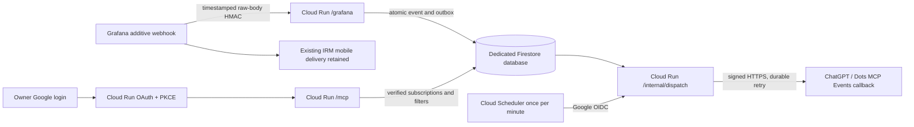

# Grafana → ChatGPT/Dots event bridge

The owner-approved bridge is deployed and connected at `https://alerts.mw-credit.com`. Its additive HMAC webhook preserves the existing IRM/mobile integration and filters ten exact alert names to firing/resolved. One enabled Scheduler drain runs each minute in Asia/Singapore. The recorded telemetry rollout is revision `00015-qcs` at 100%; use [Environment Inventory](Environment_Inventory.md) and the adopted Terraform source for current pins before any change. [Live routing and cleanup evidence](../outputs/grafana-live-activation-20261003/README.md), [telemetry acceptance](../outputs/grafana-row5-vm01-20261004/README.md).

The 5 October owner-authorized replacement of the existing registration and verified monitored-list update recovered expected membership and renewal to Healthy in the recorded UI check. The subsequent automatic renewal remains unproven. Dated native health counts and host HTTP acceptance establish only their bounded checkpoints, not every action or owner-visible notification. Eight additional bridge IRM alerts remain uncreated. [Registration recovery evidence](../outputs/grafana-row5-vm01-20261004/subscription-recovery-20261005.json).

Source: [bridge package](../scripts/monitoring/grafana-mcp-bridge/README.md). Evidence: [implementation checks and cost inputs](../outputs/grafana-mcp-bridge-20261002/README.md). Existing [monitoring operations](Resource_Monitoring.md) retain ownership of Grafana rules and mobile IRM delivery. Azure VM power control remains in its existing browser controller; there are no MCP power tools here.

## Architecture and ownership

Use one service `mw-grafana-events`, one named Firestore database and one one-minute Scheduler job in `asia-southeast1`. Scheduler drains persisted work; it does not poll Grafana. Normal callback latency is approximately 0–60 seconds plus processing/cold start time. No Cloud Tasks, VM agent or load balancer is included. Native Preview domain mapping for alerts.mw-credit.com is approved. Application infrastructure is managed in MW-Credit-App; this repository owns monitoring guidance and evidence. MW-Integration-Agent owns business workers separately.

The target is GCP project `clever-oasis-508610-n7` (`737787224638`). Named database/indexes/TTL, canonical-domain TLS, authenticated native connection and natural dispatch were verified in the linked deployment evidence. Use current inventory/source for resource identities; do not infer fresh health or authority from past acceptance.

## Protocol and authentication

The bridge implements [MCP Events](https://developers.openai.com/plugins/build/mcp-events) for protocol `2026-07-28`: `server/discover` advertises `events`, then `events/list`, `events/subscribe` and `events/unsubscribe` operate over `/mcp`. SDK v2 requires `Mcp-Method`, `Mcp-Protocol-Version`, protocol metadata, and `Mcp-Name` for tool calls. Events are custom schema handlers on the current pinned SDK.

The simplest implemented owner-only path is a reachable HTTPS Cloud Run service with application OAuth. The downstream OAuth server uses `oidc-provider`; production accepts only the narrowly pinned ChatGPT CIMD client `https://chatgpt.com/oauth/client.json` and exact redirect `https://chatgpt.com/connector_platform_oauth_redirect`. The pinned provider 9.12.2 supports native CIMD draft-02. Fetches are bounded, TLS-verified GETs with public DNS pinning and no redirects; strict document validation intersects advertised methods with the server's sole supported `none` method and imports no remote JWKS/other URLs. A 30–300 second provider cache rechecks the client pin. RFC 9207 issuer metadata is advertised by the provider and success/error redirects are tested against that exact issuer. Unknown URL clients and DCR are denied before fetching. Authorization code + S256 PKCE is required. Google login is upstream, with separate state, nonce, PKCE, verified Google ID token and an exact immutable owner `sub` plus verified email. The fixed Google callback first redirects code/state to `/oauth/interaction/<uid>/google/callback`, where the provider's signed, path-scoped interaction cookie is available. Only there are the state and interaction UID bound and consumed before exchanging the Google code. The cookie scope, nonce, PKCE and owner checks remain enforced. An internal Workspace consent app or owner-only testing configuration must be reviewed with the actual account. No API key, service-account grant, dynamic client registration or arbitrary redirect is offered to ChatGPT. See [OpenAI plugin authentication](https://developers.openai.com/plugins/build/auth).

Cloud Run IAM-only authentication expects a Google ID token rather than this OAuth access token; internal ingress cannot be reached directly by ChatGPT. IAP custom-client interoperability with this host remains unproven. The example therefore disables the invoker IAM check and authenticates each sensitive endpoint in the application; approving a public service is an explicit deployment/security decision.

| Route | Method / authentication | Purpose |
| --- | --- | --- |
| `/health` | GET, public | Minimal process health; no configuration or counters |
| `/.well-known/oauth-protected-resource[/mcp]` | GET, public | Canonical resource and authorization server metadata |
| `/oauth/*` | OAuth protocol / owner Google browser session | Metadata, authorization, token, upstream callback; no open client onboarding |
| `/oauth/token/revocation` | POST, registered OAuth client plus its owner token | Advertised token revocation; refresh-token revocation invalidates the grant and queued delivery authority |
| `/mcp` | MCP, bearer access token with owner, client, audience, scope and live grant checks | Events and two read-only tools |
| `/grafana` | POST, Grafana timestamp + raw-body SHA-256 HMAC | Accept alert transitions into durable storage |
| `/internal/dispatch` | POST, verified Google OIDC token, exact Scheduler email/audience | Bounded outbox drain |

Duration consent and the canonical Origin/callback CSP repair are deployed. The retained callback regression evidence covers the actual cross-origin redirect, unlike the earlier same-origin test. Native access was observed beyond the five-minute access-token interval; the 5 October registration recovery separately observed authoritative grant expiry. These checkpoints do not prove browser-session independence or future automatic renewal. [Consent/callback recovery](../outputs/grafana-offline-auth-20261004/callback-rollout.json), [native acceptance](../outputs/grafana-offline-auth-20261004/native-acceptance.json), [cross-origin regression](../outputs/grafana-offline-auth-20261004/browser-callback-regression.json).

Every new authorization for the pinned client requires the configured owner to choose **Allow two-year access**, **Continue session-only**, or **Cancel**, even when the client omits optional offline_access/prompt or has an existing browser grant. prompt=none fails when this interaction is required. The deployed callback repair adds only the existing pinned ChatGPT callback to the consent page form-action policy, alongside self; unknown form destinations remain blocked. The consent page uses Referrer-Policy: strict-origin, preserving the canonical browser POST Origin while sending no referrer path/query; other routes keep no-referrer. Null and foreign Origins remain rejected. Browser approval requires the signed interaction cookie, exact owner, canonical client/resource, same-origin POST and a single-use ten-minute CSRF nonce bound to the interaction/request. Cancel grants no authority. Both acceptance choices create a fresh grant; existing grants are never automatically extended or upgraded.

Two-year approval stores an encrypted OwnerConsent record in the existing oauth collection, bound to issuer, grant, owner, pinned client and resource, with a fixed 730-day deadline from explicit approval. The narrowly scoped expiresWithSession exception applies only when that durable consent verifies. Marked grant/code/refresh/access-token reads also reject missing, expired, corrupt or mismatched consent. Session-only approval preserves session binding and a maximum 30-day grant and rejects offline_access. Five-minute access tokens, 60-second codes, ten-minute interactions and one-day browser sessions remain. Rotation retains the original grant/token deadline; refresh never starts another two years.

Authorization-server discovery may advertise offline_access, but this optional client parameter is no longer necessary to reach the owner's duration choice. Both issuer documents advertise the normal authorization endpoint without a prompt query and use no-store. Protected-resource metadata and WWW-Authenticate retain only mcp:events and mcp:read, per [MCP refresh guidance](https://modelcontextprotocol.io/specification/2026-07-28/basic/authorization#refresh-tokens). No requested API scope is broadened. mcp:events gates Events operations; mcp:read gates tools. Subscriptions remain bounded to24 hours and their grant deadline. Revocation/reuse invalidates grant authority through731-day tombstones; owner-disabled control blocks reads, refresh and delivery. The last pre-send check is the revocation boundary: HTTPS already in flight cannot be recalled.

The callback-host allowlist may be empty for staged OAuth startup; this denies all subscriptions before reading the signing secret, writing subscription state or making a challenge request. Only a preverified exact callback-host allowlist is permitted for delivery. Retrieve the actual callback hostname from approved host/plugin setup metadata; never guess it or approve a wildcard. The callback must use HTTPS/443, have no userinfo/fragment, and resolve exclusively to public unicast addresses. Every verification/delivery resolves DNS afresh and pins an approved address while checking TLS against the original hostname. Special-use, mapped and transition addresses, mixed public/private responses and redirects are rejected. A single absolute ten-second timeout covers DNS and HTTPS; response bodies are capped at 8 KiB.

## Persistence and delivery behavior

`grafana.alert.transition` supports exact `alert_names`, `components` and `statuses` arrays. Filters are sorted/deduplicated before hashing subscription identity. Signed verification sends a random challenge and requires the same challenge in a 2xx JSON response. Same-identity/same-key verification is cached for five minutes; changing the signing key verifies again and dual-signs for five minutes. Durable subscription keys and OAuth state/tokens are encrypted with AES-256-GCM.

Subscriptions have a finite default/maximum 24-hour lifetime and honor shorter requested lifetimes. New authenticated subscriptions also expire no later than their authorizing grant. The host must refresh before `refreshBefore`; a null request gets the finite default. Up to eight active subscriptions are allowed. Unsubscribe is idempotent. Optimistic revision checks prevent concurrent refresh from undoing an unsubscribe. A separate persistent `subscriptionControls` cancellation generation also fences an initial challenge when unsubscribe succeeds before any subscription row exists. It survives subscription TTL deletion; a later intentional subscribe snapshots the new generation and is permitted. These hashed identity/counter records have no TTL and contain no URL or secret. Replay cursors are unsupported; neither a new subscription nor refresh backfills old events.

Grafana ingress accepts at most 50 alerts and 256 KiB per request. `truncatedAlerts>0` is rejected to avoid silently omitting instances. Grafana must send resolved notifications; leave Max Alerts at zero (unlimited) and reconcile grouping so actual requests stay inside these bounds. A new additive integration must preserve current IRM/mobile delivery. The operating reference lists all ten rules, including scheduled backup health; recorded contact-point membership and subscription filters match these names.

Event identity includes source, fingerprint, canonical start time, status and resolved end time. Changing a firing reminder's end time does not create another event; resolution and later recurrence remain distinct. In one Firestore transaction, a new event and all matching deliveries are inserted, with at most 450 writes (50 events × nine records). Concurrent duplicate ingress creates no duplicate outbox entry. A retry after retention can create the same event again; the 30-day deduplication window is finite.

Payloads contain only source, fingerprint, alert name, component, status, start/end time, a summary capped at 1,000 characters and an optional dashboard URL restricted to `https://monitor.mw-credit.com`. Labels, raw annotations, Grafana body and credentials are not copied wholesale. Summaries remain untrusted external content; downstream instructions must treat them as data and must not authorize arbitrary commands from an alert.

Each Scheduler run claims at most 20 deliveries sequentially, using a 30-second lease and random fencing token. Stable event ID and serialized body survive retries; Standard Webhooks signatures/timestamps are renewed. An old worker cannot overwrite a newer claim's result. Network errors, 408, 429 and 5xx retry after exponential backoff starting at 60 seconds with jitter, capped at one hour. Other 4xx are terminal; 410 also disables the corresponding unchanged subscription. Retry budget is 12 claims or 24 hours. Expired, unsubscribed or revoked subscriptions cancel queued sends. Delivery is **at least once**, potentially out of order: downstream must deduplicate by event ID. A crash after host acceptance but before the stored acknowledgment can duplicate a send.

The bridge treats any 2xx as accepted, even when the host executes asynchronously. Host action success and owner-visible notification are separate acceptance evidence. Do not automatically replay failed/dead-letter records; inspect authority, age and prior host acceptance before an explicitly authorized recovery.

Maintain [index/TTL definitions](../scripts/monitoring/grafana-mcp-bridge/deploy/firestore-indexes.json) for the chosen database through its adopted infrastructure source. Events retain 30 days, deliveries 31 days, subscription records eight days and grant-revocation tombstones 731 days. OAuth/state records have record-specific expiries. TTL deletion is asynchronous; application expiration checks enforce authority independently. Sensitive payload fields are exempted from automatic indexes. Native Firestore transaction reads are staged before writes; actual transaction/index acceptance is recorded in deployment evidence; recheck affected behavior after a relevant change.

## Runtime configuration and secrets

`PUBLIC_BASE_URL` must be the actual HTTPS origin without path/query. `OAUTH_ISSUER=origin/oauth` and `MCP_RESOURCE=origin/mcp` must agree. Set verified owner Google subject/email, the pinned ChatGPT CIMD identity/exact redirect (built-in constants; conflicting environment values are rejected), Google OAuth client ID, an empty callback allowlist until exact hosts are verified, fixed Grafana source ID, selected project/database and dedicated Scheduler email. The [service example](../scripts/monitoring/grafana-mcp-bridge/deploy/service.yaml.example) shows required names and unresolved placeholders.

The runtime mounts five pinned Secret Manager versions:

| Secret file variable | Format / handling |
| --- | --- |
| `GRAFANA_SECRETS_FILE` | JSON array of one or two strong HMAC secret strings; overlaps old/new Grafana signing during rotation |
| `STATE_KEY_FILE` | Canonical base64 of 32 random bytes; encrypts persistent OAuth and callback secrets |
| `COOKIE_KEYS_FILE` | JSON array of one to three strong keys, newest first; retain prior keys across session rotation |
| `OAUTH_JWKS_FILE` | Private signing JWKS with stable key IDs and supported signing algorithms; retain verification overlap |
| `GOOGLE_CLIENT_SECRET_FILE` | Google web OAuth client secret |

Create keys through the approved secret-management route, never repository files, command output or chat. Use runtime workload ADC; do not generate a service-account JSON key. Pin secret versions and image digest for recovery. **Replacing the state encryption key without migrating existing ciphertext loses durable authorization/callback secrets.** Its rotation needs a separately reviewed migration/recovery plan; cookie/JWKS rings and Grafana HMAC rotation do not migrate the state key.

Minimum runtime IAM must be reviewed against the actual named database: read/write only this bridge database, access only its five secrets, and no Azure or Cloud SQL administration. Verify database-level IAM/conditions are supported and effective before granting access; do not silently replace them with broad project-wide grants. The separate Scheduler identity needs no datastore/secret access. Its token audience must equal `origin/internal/dispatch`, and the app verifies its exact email. Builder/deployer permissions are separate from runtime permissions.

The application logs only allowlisted event names, numeric counts/statuses and the bounded RPC projection described in [diagnostic evidence](../outputs/grafana-rpc-diagnostics-20261003/README.md): fixed method labels, boolean outcomes, numeric RPC error codes and tool/event list counts. Tokens, bodies, IDs, identities, headers, callback data/URLs, tool arguments and exception details are excluded, except the separately approved temporary opt-in [strict synthetic hostname-only capture](../outputs/grafana-callback-host-diagnostic-20261003/README.md). **Cloud Run platform request logs can include OAuth callback query codes/state.** Preserve and verify the configured Cloud Logging exclusion for `/oauth` request logs (or an equivalent approved redaction route) after relevant logging changes. Application log redaction cannot sanitize platform logs. Keep operational logging for ingress/drain and review retention/billing. Provider debug logging must remain off.

## Cost model

Run `npm run estimate` using the [editable assumptions](../scripts/monitoring/grafana-mcp-bridge/tools/cost-assumptions.json). [Saved output](../outputs/grafana-mcp-bridge-20261002/cost-estimate.json) models 30 days, 1,000 transitions, two subscriptions, 10% retries, 43,200 Scheduler ticks, 0.2-second empty ticks/ingress, 0.5-second callbacks, 30 cold starts, 1 vCPU/0.5 GiB, 0.1 GiB stored data and five active secret versions. These timings are estimates, not Cloud Run measurements.

| Scenario | Calculated incremental USD/month |
| --- | ---: |
| Listed account-level allowances still available; named Firestore database paid | 0.048277 |
| Listed allowances exhausted | 0.905874 |

The named database pays reads/writes/storage; only eligible default databases get Firestore free quotas, with daily reset and burst caveats. TTL deletes remain billable. Scheduler charges per job, not per execution: one job can consume a remaining free slot or cost $0.10/month under these inputs. The model includes durable retries, mounts, image storage, builds, logs and estimated Internet egress. US$1–5/month is a contingency budget, not a promised bill, minimum or ceiling. Bursty alerts, retries/cold starts, duplicate ingress and OAuth activity can exceed this sample.

The target region is `asia-southeast1`; the listed USD rates are reference/default table inputs, **not confirmed Singapore prices**. Rates are editable review inputs checked against [Cloud Run](https://cloud.google.com/run/pricing), [Firestore](https://cloud.google.com/firestore/pricing), [Scheduler](https://cloud.google.com/scheduler/pricing), [Secret Manager](https://cloud.google.com/secret-manager/pricing), [Cloud Build](https://cloud.google.com/build/pricing), [Artifact Registry](https://cloud.google.com/artifact-registry/pricing) and [Logging](https://cloud.google.com/stackdriver/pricing) tables. Confirm Singapore selection, database edition/storage, destination-dependent egress and actual remaining allowances using the billing calculator before approving deployment. Cloud Build free capacity is promotional and machine/pool-specific. Domain, load balancer, backups/PITR, paid dashboard plan and ChatGPT/Dots execution charges are excluded. A load balancer would materially change this low-cost design and needs separate approval.

## Change and acceptance procedure

Use the adopted MW-Credit-App infrastructure roots and current environment inventory; historical bootstrap scripts are provenance/recovery references, not an alternate live management path. Existing scoped authority applies to its reviewed change only.

1. Pin the tested source/image and secret versions; capture the affected current configuration and rollback. Verify exact project, region, named database, service, registry, identities, current route/filter and billing assumptions. Preserve unrelated state and owner access.
2. Preserve app-authenticated public ingress, exact origin/issuer/resource, owner/client checks and OAuth request-log exclusion. Verify non-root Linux amd64 execution, min instances zero, max two, 1 vCPU/512 MiB, concurrency 20 and 300-second request timeout against current reviewed configuration. No workload ADC JSON key or broad runtime grant is required.
3. Preserve one Scheduler POST `{}` each minute in Asia/Singapore, region asia-southeast1, exact OIDC service-account email/audience, 240-second deadline and zero retries unless separately authorized to change. Storage/network fencing remains required. Observe the next natural tick rather than manually dispatching or resending.
4. For authentication/subscription changes, retain pinned CIMD/redirect, owner Google identity, canonical callbacks and the verified exact callback-host allowlist. Check affected token refresh, Events/filter/expiry and tool guards. Unverified hosts deny delivery; do not guess/wildcard, export tokens or create another automation to work around access.
5. Preserve the additive Grafana SHA-256 timestamped raw-body HMAC route and original IRM/mobile delivery. Max Alerts remains zero, resolved notifications enabled and actual grouping within the ingress bounds. Synthetic firing/resolved delivery needs explicit notification scope; host 2xx alone is insufficient owner-visible acceptance.
6. Run only affected source/protocol/index checks, verify saved configuration and bounded natural telemetry. Inspect backlog/retry/expiry and current costs before changing limits or adding queues. `get_bridge_health` caps each count at 100 and is not a complete backlog metric. Record results in the existing change/release record.

## Recovery and canonical hostname

For containment, pause the bridge Scheduler and disable/remove only the newly added Grafana webhook integration; preserve the IRM contact point/routes. Disable the owner control/config and revoke affected grants when needed. In-flight delivery can complete. Record uncertain host acknowledgments before any replay.

For revision rollback, restore the known image digest and canonical configuration with retained pinned secret versions and the same durable database/state key. Validate schema/index compatibility and owner authority before resuming. Do not delete the database, secret versions or durable outbox as part of routine rollback.

The canonical hostname `alerts.mw-credit.com` uses the owner-approved native Cloud Run Preview domain mapping; domain/DNS/TLS readback passed in [bootstrap evidence](../outputs/grafana-mcp-bootstrap-20261002/README.md). Preserve adopted DNS/mapping and canonical configuration together. A plain CNAME does not create verified TLS/routing. Native mapping has documented production caveats; a load balancer is not approved. The [bootstrap reference](../scripts/monitoring/grafana-mcp-bridge/deploy/OWNER_BOOTSTRAP.md) retains original conflict checks and generated DNS-record handling for recovery.

A later migration must verify domain ownership/TLS/routing first, update the upstream Google callback and allowlist, then change origin/issuer/resource together. The ChatGPT-owned redirect remains unchanged unless its actual management configuration changes. Old issuer/audience tokens and browser sessions will require reauthorization; connect/refresh new subscriptions and disable/drain old ones deliberately to avoid double delivery. Keep the previous host/revision/configuration and state key available for rollback until acceptance is complete.
