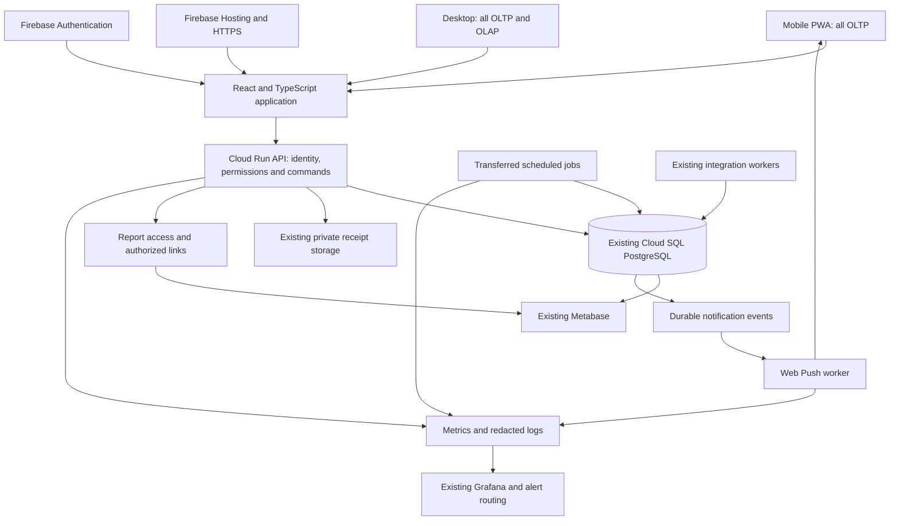

> Historical proposal preserved from closed PR #17 on 12 October 2026. Current implementation and release status are governed by PWA_Progress.md and Release_Tracker.md; this document does not reopen work or override the deployed design.

# MW Credit PWA rebuild high level design

**Draft for owner review · 7 October 2026 · Asia/Bangkok**

Rebuild the AppSheet applications as **one responsive React and TypeScript PWA**, with a mobile operations workspace and a desktop operations and management workspace. Put the new application in a **new private GitHub repository**, proposed name `welct0407/MW-Credit-App`. Keep the existing PostgreSQL databases, Metabase deployment, Grafana stack, private receipt storage and integration services. Enhance their interfaces and monitoring incrementally rather than replacing their data or deployment.

Mobile must cover all current OLTP capabilities. Desktop must cover all current OLTP and OLAP capabilities, including OLAP's editable management workflows. Mobile OLAP expansion is a later option. **Owner decision in this chat: payments require online confirmation; offline viewing and drafts are included.**

**Owner transition requirement: operate the old AppSheet apps and new PWA in parallel first, then cut over seamlessly.** Both frontends use the same authoritative records. Users can continue normal work in AppSheet while the PWA is introduced and validated; retirement follows successful coexistence and a staged switch, rather than a separate-data migration or abrupt replacement.

This remains the feature and coexistence design, not a completed feature-parity certification. On 7 October 2026 the owner authorized infrastructure implementation and the new private repository [welct0407/MW-Credit-App](https://github.com/welct0407/MW-Credit-App) was created. Its [development runbook](https://github.com/welct0407/MW-Credit-App/blob/main/docs/Development.md) owns the new Terraform, Cloud Run, Firebase Hosting, credential management and tooling details. Application implementation belongs there; shared SQL migrations remain here. Existing AppSheet, Metabase and Grafana services are retained.

## 1. Basis and changes to the shared idea

The [shared platform discussion](https://chatgpt.com/share/6ac5e18b-2730-83ec-9a07-fb54d5d0d29a) supplies the PWA, mobile push and GitHub-first direction. This design adapts it to the maintained [solution design](Solution_Design.md), [business model](AppSheet_Data_Model_Overview.md), [environment inventory](Environment_Inventory.md), [dictionary](Data%20Dictionary/README.md) and [execution responsibilities](Development_Workflow.md).

The key adaptations are:

- Preserve both `loan_manager_dev` and `loan_manager_prod` on the existing shared Cloud SQL instance. Local disposable databases supplement them; no preview connects to PROD.
- Rebuild OLAP management features in the desktop PWA. Metabase supplies reporting, not partner settlement or cash administration forms.
- Retain SQL posting and governed calculations. Do not reproduce the shared chat's illustrative table names, payment rules, penalties or schedules as new business requirements.
- Continue one immutable Flyway migration sequence under one repository owner. A new application repository does not create a second database history.
- Automate deployment after scoped production authorization. Merging a PR alone does not authorize production effects under current project rules.
- Budget incremental costs against the retained ecosystem. The shared chat's standalone cost estimate is not this project's verified total cost.

The repository checkpoint used for this draft is `7755fe2eae3dee98c64fb51e9afba08fa8ebba37`. The inventory's 5 October closeout records SQL V58 and PROD OLTP 3.000263 / OLAP 1.100208. These are documented checkpoints, not live observations made for this design. Newer applicable release evidence must be incorporated at implementation start.

## 2. Target architecture



DEV and PROD each have separate frontend configuration, authentication trust, API identity, database credentials and notification destinations. The diagram shows logical relationships; it does not imply a browser connection to PostgreSQL, direct unprotected storage access or new public reporting access.

| Layer | Proposed choice | Responsibility |
| --- | --- | --- |
| UI | React, TypeScript, Vite, PWA manifest and service worker | Responsive layouts, forms, navigation, Thai/English text, offline shell and drafts |
| Hosting | Firebase Hosting | Static delivery, HTTPS, versioned frontend and preview URLs |
| Identity | Firebase Authentication | Sign-in and verified identity; API separately decides business permissions |
| API | Node.js/TypeScript modular application on Cloud Run | Validate requests, authorize records/actions, call existing SQL, return confirmed results |
| Financial engine | Existing PostgreSQL functions, triggers, constraints and views | Posting, allocations, locking, balances, financial corrections and reporting logic |
| Files | Existing private GCS storage | Receipt objects with API-authorized upload/read access |
| Notifications | Standards-based Web Push and VAPID | Device subscriptions and delivery after a committed business event |
| Jobs | Cloud Scheduler and Cloud Run execution, introduced job by job | Replace only AppSheet-owned jobs whose cutover is approved |
| Analytics | Existing Metabase and governed SQL | Portfolio, cash, income, cashflow, borrowers, health, partners and forecasts |
| Observability | Existing Grafana plus new service telemetry | App/API/job/push health and incremental cost visibility |
| Delivery | GitHub Actions, Terraform and Playwright | Reviewable source, repeatable infrastructure, automated checks and deployments |

Start with one API deployment organized into business modules, plus independently invoked job/notification execution. Avoid a separate service per business entity. Share API contracts and validation schemas with the frontend; authoritative financial calculations remain in SQL.

Firebase supports GitHub preview workflows. Use federated GitHub authentication and CLI deployment as the intended implementation, rather than assuming the generated Firebase workflow's credential method is suitable unchanged. [Firebase previews](https://firebase.google.com/docs/hosting/github-integration), [Google GitHub authentication](https://github.com/google-github-actions/auth), [Firebase CLI credentials](https://firebase.google.com/docs/cli).

## 3. Mobile and desktop coverage

The following is the high-level coverage baseline. Every currently enabled workflow must later map to its actual AppSheet views/actions/bots, SQL dependency and acceptance test. Generated actions, disabled bots and dormant exports need explicit classification so they are neither accidentally activated nor silently dropped.

| Capability | Mobile first release | Desktop first release | Preserved contract |
| --- | --- | --- | --- |
| Dashboard and navigation | Full OLTP dashboard and entry points | OLTP dashboard plus management navigation | Operational SQL totals and access scope |
| Borrowers | Search, create/edit allowed fields, detail, persistent notes, preferences and related records | Same plus analytical review | Immutable IDs, required English name and current editing ownership |
| Loan lifecycle | All three existing loan types, creation, first-day handling, allowed term/principal actions, closure/default and review | Same | Original-rate immutability, existing schedules, capacity and correction guards |
| Charges and collections | Today's collection, charge detail, Receive All, single/full/partial and selected-charge workflows | Same, with wider tables and filters | Exact eligible residuals; selected-charge payment has no spillover |
| Payments and history | Entry, status/error review, allocations, repayments, permitted corrections and receipt review | Same | Receipt/allocation/repayment grain and one source cash effect |
| Upcoming charges | Current date summaries and borrower/date drilldown | Same | Tomorrow to T+7 menu; first five future dates within current bounded horizon; read-only forecast |
| Receipt files | Camera/file upload, replace permitted manual image, inspect manual and agent evidence | File upload and larger preview | Manual upload does not start OCR or create a second payment; agent evidence remains protected |
| Expenses and rebates | All current OLTP manual expense actions and related review | Same plus management reporting | Signed adjustments, existing payer-account validation and SQL rebate rules |
| Cash visibility | OLTP cash dashboard, balances and recent account/date statements | Same plus full historical review | Custody is distinct from partner entitlement; unknown openings remain unknown |
| Cash administration | Only capabilities already in OLTP | Holders/accounts, approved ledger commands, transfers, opening handling and correction/reversal workflows | Port only permitted current OLAP actions; never expose generic ledger editing |
| Partners and contributions | Existing OLTP read use | Partner management, login/delivery/language/reviewer preferences and capital contribution workflows | Preserve identity, entitlements, reservations and source tracing |
| Settlements and allocations | Later OLAP expansion | All current creation, exact amount/settle-all, reservation, completion, reversal and cancellation actions | SQL prevents over-reservation; cancellation is auditable |
| Assessments and analytics controls | Later OLAP expansion | Loan assessment inputs/results, statistics, history refresh/rebuild and current OLAP analysis | Human management actions remain distinct from read-only BI |
| Reports and exports | Existing OLTP report links and outputs; broader OLAP optional later | All current OLAP reports/outputs plus Metabase navigation | Date windows, live/snapshot labels, freshness and approved destinations |
| Notifications and preferences | Push, notification history, deep links, language and device management | Same where permitted | Preserve event conditions and recorded actor routing |
| Automation-dependent behavior | All effects needed by OLTP workflows | All effects needed by OLTP and OLAP | Exactly one active executor for each job/channel during transition |

**Mobile navigation:** Home, Collections, Borrowers, Payments and More. More includes Loans, Charges, Upcoming Charges, Expenses, Cash Statement, notification history and preferences as applicable. All OLTP actions remain reachable; placing an action in More is not a scope reduction.

**Desktop navigation:** Operations, Cash, Partners and Settlements, Assessments, Reports, and Administration. Use shared detail/form components, side-by-side record context and keyboard-friendly tables. Desktop feature access depends on permissions, not viewport size; mobile layout alone must never be treated as an authorization control.

Preserve existing Thai/English preference behavior and business terminology. Monetary calculations use PostgreSQL numeric values and explicit rounding; browser calculations are previews. Bangkok business dates, transfer timestamps and UTC event timestamps remain distinct. Display whole baht only where the current presentation contract requires it.

## 4. API and financial integrity

The API exposes business commands such as receive a payment, close a loan, record an expense or complete a settlement. Endpoint and SQL routine names are chosen from inspected implementation contracts during detailed design; this proposal invents no executable SQL interface.

For a payment:

1. Verify the signed-in identity, resolve the Partner and check operation and record permissions.
2. Accept a stable request ID and validated command payload. The actor comes from authenticated server context, not a browser-supplied email.
3. Under existing SQL transaction/locking rules, recheck charges, amount, date and receiving account, then invoke the established posting path. Do not insert allocations or cash entries independently of that path.
4. Record audit and a durable notification intent consistently with the committed result, reusing suitable existing facilities or adding an approved mechanism.
5. Return the authoritative payment status and result. A pending, processing or unknown result is never displayed as Posted.
6. Deliver notifications after commit. Notification failure must not roll back or duplicate a payment.

Persist request identity across retries, reject reuse with a different payload, and support status lookup after a timeout. Existing database locking protects concurrent AppSheet, worker and PWA operations. Preserve signed reversals and date rules; do not add a blanket ban on negative values that would invalidate approved adjustments.

Use separate least-privilege runtime, reporting and migration identities. The API must reproduce relevant AppSheet security filters and update permissions server-side. Firebase validates identity; it does not automatically reproduce those filters. Verify issuer/audience/environment and current membership; revoke access promptly when a Partner is disabled. [Firebase token verification](https://firebase.google.com/docs/auth/admin/verify-id-tokens).

Initially resolve verified login identity through the current normalized `Partners.Login Email` contract. An explicitly provisioned stable Firebase UID binding is a proposed enhancement; it must not silently create new Partners or merge people sharing a delivery email. Preserve `AI Reviewer` as a separate business permission rather than granting it to every app administrator.

## 5. Offline behavior, installation and push

**Accepted first-release boundary:** cache the application shell and a limited, timestamped operational dataset; allow local drafts; require online revalidation and server confirmation before posting financial commands. Reconnection never automatically posts a draft. Refresh authoritative balances, let the user review changes and submit deliberately. A request already sent before disconnection retains its ID and is reconciled before another attempt.

Offline data is device-local, access-scoped and time-limited. Clear caches and drafts on sign-out/account switch; exclude receipt images from default caching. Explain that an offline device cannot learn of access revocation immediately. Use visible stale-data and unsent-draft states, and test storage eviction, expired sign-in and midnight date changes. Offline financial posting is outside v1 by the owner's decision.

Use an installable Home Screen PWA with a manifest, icons and a service worker. On iOS/iPadOS 16.4 and later, Home Screen web apps support Web Push with permission requested after user interaction; Apple Developer Program membership is not required. Validate installation and push on the actual supported phones. [WebKit platform guidance](https://webkit.org/blog/13878/web-push-for-web-apps-on-ios-and-ipados/).

Store subscriptions per authenticated person/device and environment. Preserve the existing actor-to-Partner exclusion rule. For retained email channels, deduplicate delivery addresses as today; for push, target eligible Partners' subscriptions and deduplicate endpoints. Shared email addresses must not collapse distinct people. Unknown actors produce no business recipients and an investigation signal.

Use bounded retries, stable event IDs, expired-subscription cleanup and an in-app notification history. Push delivery is best effort; sending to a push endpoint does not prove the user saw it. Default lock-screen text should avoid borrower/payment details, with an authenticated deep link to the event. Preserve current channels until an approved replacement has passed owner-only DEV tests. Treat the new push channel's detailed recipient policy as a review item.

## 6. Retain and enhance the existing services

| Existing asset | Keep | Targeted enhancement |
| --- | --- | --- |
| PostgreSQL | Existing instance, DEV/PROD databases, keys, financial rows, functions, views and migration history | Narrow API roles; inspected command adapters; audit/request identity and durable notification support where gaps exist; measured indexes |
| Metabase on Railway | Current application database, dashboards/questions, governed providers, access, backups and custom borrower matrix | PWA report navigation, immutable-ID/date drill-through, optional selected embedded panels and aligned freshness labels |
| Grafana Cloud | Performance/Cost dashboards, current provider monitoring, alert delivery and incident routing | API availability/latency/errors, connection use, job lateness, notification backlog, failed-command counts and new costs |
| Private receipt bucket | Existing objects, references and protection | API-authorized upload/read sessions, file validation and access checks; preserve manual/agent ownership distinction |
| Debian integration services | Current runtime, catalogues, journals, message handling and operational authority | Versioned API/identity adapters only where AppSheet-specific dependencies must be replaced |

### PostgreSQL

Keep compatibility with both existing apps and reports throughout migration. New schema objects require justified need, dependency review and owner approval. Candidates include identity binding, device subscriptions, request deduplication, notification history/outbox and broader API audit capture; these are logical needs, not instructions to create six new tables. First inspect what can be reused. Existing agent-specific audit capture does not by itself establish complete PWA coverage.

Bound Cloud Run instance counts and per-instance connection pools against the shared database's measured available capacity, including AppSheet, Metabase and workers. Adopt a supported Cloud SQL connector/attachment for the new runtime only after target and access review; preserve other clients' working connectivity. No instance upgrade, network-policy change or proxy replacement is assumed. [Cloud Run connection guidance](https://cloud.google.com/sql/docs/postgres/connect-run).

### Metabase

Start with authenticated links to the existing reports. This retains full report capabilities without making an unverified embedding licence assumption. Desktop PWA forms own OLAP management actions; Metabase stays read-only reporting.

Selected dashboards can later use signed guest embeds if their access contract is suitable. Generate short-lived tokens server-side, lock authorization-related filters and enforce export/data boundaries. Full interactive SSO embedding currently requires a qualifying paid plan; verify the installed edition and licence before committing to it. Never publish sensitive dashboards merely to fit an iframe. [Metabase embedding options](https://www.metabase.com/docs/latest/embedding/introduction).

Reuse governed metrics and existing borrower/date filters. Preserve current versus historical snapshot semantics, unknown/missing data and forecast limitations. Do not rebuild the entire report estate in React or query broad operational tables from the browser.

### Grafana and integrations

Add application telemetry to the existing monitoring design. Use low-cardinality labels and redact borrower details, tokens and receipts from logs. Establish measured baselines before choosing alert thresholds; distinguish failed posting from failed notification. Update the dashboard visual guide with any later saved dashboard changes.

Keep existing integration and AI Collection ownership in their own repositories. Inventory references to AppSheet app IDs, deep links, authentication and APIs before retirement. Existing enabled/disabled states and manual-review boundaries survive the rebuild. This design does not authorize new autonomous lending decisions or activate dormant workers.

## 7. New repository and shared ownership

Proposed application repository: **`welct0407/MW-Credit-App`**, private, with the intended existing project audience. Confirm the final name and audience during bootstrap. Do not clone the old repository wholesale into it.

```text
MW-Credit-App/
  apps/pwa/                 responsive UI, translations, offline drafts
  services/api/             authorized business commands and queries
  services/jobs/            approved transferred jobs and notification delivery
  packages/contracts/       API types and request validation
  packages/ui/              shared presentation components
  database/                 pinned dependency manifest and contract tests
  infrastructure/terraform/ new application infrastructure only
  tests/                    API, database, parity and browser tests
  docs/                     architecture, feature map, decisions and runbooks
  .github/workflows/        checks, previews and approved releases
```

| Repository | Initial responsibility |
| --- | --- |
| New MW-Credit-App | PWA, API, new app infrastructure, app-owned jobs, tests and app releases |
| Existing AppSheet-Loan-Project | Canonical shared Flyway migrations, current AppSheet transition work, shared reporting/monitoring definitions and ecosystem coordination |
| MW-Integration-Agent | Existing integration services and their service catalogue |
| MW-AI-Collection | Collection-specific services under its separate default-deny catalogue |

During coexistence, the new repository pins an exact shared-database source commit, migration list and hashes. It consumes the tested package; it must not carry an independently editable migration copy or its own Flyway history for the same database. Cross-repository releases record both revisions and compatibility. Coordinate shared DEV changes with the existing sole Open release.

After AppSheet retirement, shared SQL ownership may transfer once to the new repository through a separately reviewed handoff preserving every migration version/checksum and history entry. Freeze migration authoring during that transfer and disable the former runner. Do not transfer ownership simply by copying files.

Terraform initially manages new application resources only. Existing Cloud SQL, storage, Railway, Grafana and tunnels remain external dependencies. Any later adoption/import requires a reviewed no-destroy plan and its own authority. Keep state private and access-controlled, not in Git; separate DEV/PROD state and deployment identities.

## 8. Environments, delivery and recovery

| Environment | Data and side effects | Use |
| --- | --- | --- |
| Local/CI | Disposable PostgreSQL with synthetic data; mocked notifications; local auth test support | Unit, migration, API and business-contract tests |
| PR preview | Static preview plus synthetic/mock API by default; no PROD secrets | Layout, navigation, bilingual and automated UI review |
| Integrated DEV | Existing `loan_manager_dev`, dedicated API identity, test file namespace and owner-only approved delivery | Shared app/SQL/worker parity testing under coordinated access |
| PROD | Existing `loan_manager_prod` and retained service ecosystem | Only the accepted immutable release after scoped authorization |

A frontend preview URL does not isolate its backend. Any preview using integrated DEV must declare that binding, restrict access and serialize conflicting tests; destructive test resets never target shared DEV. Default synthetic previews avoid this dependency. Existing receipt storage currently has a shared DEV/PROD bucket exception; new PWA DEV access needs an explicitly enforced test namespace or separately approved storage, not an assumption that a bucket name isolates files.

GitHub Actions performs type/lint checks, meaningful business tests, migration compatibility checks and Playwright browser checks, then produces a preview and immutable artifacts. Use browser projects for mobile/desktop and relevant engines; actual Home Screen installation, camera and push still need physical-device checks. [Playwright projects](https://playwright.dev/docs/test-projects).

For production, build once and promote the tested image/frontend versions. Use a protected release job bound to the approved commit and database package. Apply compatible SQL changes before code that requires them, then API/jobs, then frontend. Test old-client/new-API compatibility because installed PWAs can retain an older service worker. Prompt users to update without discarding drafts or interrupting uncertain payment requests.

Recovery selects previous compatible frontend/API artifacts and routing flags; it does not reverse committed payments. Preserve idempotency records and notification delivery state. Verify database backup/restore coverage before production writes; Git does not back up financial rows, authentication users, secrets, Terraform state, Metabase's application database or receipt objects.

## 9. Migration sequence and acceptance

| Phase | Deliverable | Exit evidence |
| --- | --- | --- |
| 0. Baseline and parity map | Current enabled OLTP/OLAP features, roles, bots, outputs, integrations and SQL contracts | Every active feature mapped to a replacement and test; dormant items identified; no unresolved scope omission |
| 1. Foundation | New private repository, synthetic preview, app shell, authentication, API read path and CI | Target isolation, access denial, mobile/desktop layout and Thai/English review pass |
| 2. OLTP parity | Borrowers, loans, charges, payments, expenses, receipts, cash visibility and push | All OLTP workflows pass in DEV, including concurrent writes and failed/unknown requests |
| 3. Desktop OLAP parity | Partners, contributions, settlements, cash administration, assessment and reporting links | All current OLAP workflows and report navigation pass with preserved permissions and metrics |
| 4. Parallel production operation | Accepted PWA pilot alongside fully usable AppSheet, shared records, common event handling and telemetry | Cross-client writes/readback, natural schedules, notifications and no duplicate posting/sending verified |
| 5. Gradual default switch | Expand PWA adoption by user/workflow while AppSheet remains available | Full parity, reconciliation, stable operation over an agreed business-cycle window and fallback drill pass |
| 6. AppSheet retirement | Drain old-client activity, retain read-only access for the agreed period, then remove remaining dependencies | Zero unresolved old-client writes, owner cutover acceptance, backups and explicit retirement authorization |

Pilot does not satisfy final scope until mobile OLTP and desktop OLTP/OLAP are complete. Broader mobile OLAP comes after this baseline.

### Parallel operation and seamless cutover

The target is **two usable frontends, one database and one execution owner per background business effect**. The PWA does not maintain a second financial ledger. Existing keys and file references are preserved, so a borrower or posted payment created in either app is the same record in the other after its normal refresh/sync. AppSheet sync latency must be visible in testing; shared storage alone does not mean both screens refresh instantly.

1. **Make shared contracts compatible first.** Additive migrations must pass both old-AppSheet and new-API tests. Reproduce AppSheet-side validations and business actions needed for PWA-originated writes. Direct API/SQL writes must not be assumed to trigger AppSheet data-change bots. Capture a dependency matrix for each command: SQL effects, AppSheet event actions, external integrations, files and notifications.
2. **Preserve cross-client consistency.** Use common database locks, constraints and canonical posting functions for AppSheet, PWA and workers. PWA requests have durable idempotency IDs. These do not automatically deduplicate a second manual entry from AppSheet: show current posted results and refresh/revalidate before commands, preserve existing source/reference uniqueness and add a shared business-event identity only where the actual workflow supports one. Never deduplicate solely on borrower, amount and date, because legitimate receipts can match. An uncertain cross-app duplicate requires reconciliation, not an automatic second posting.
3. **Make events work from either app.** Establish durable committed-event handling for the workflows adopted by the PWA, reusing existing suitable journals or approved additions. Notification/event delivery ownership is defined by event and channel, with one deduplication identity. During transition, existing AppSheet notifications may handle AppSheet-originated events while the new worker handles PWA-originated events only if origin separation is verified. Before moving to a common worker, drain the old path and record a cutover boundary so old and new delivery paths cannot resend the same event. Actor routing remains identical.
4. **Keep one scheduler per job.** Parallel frontends do not require parallel daily-charge generation or analytics refresh. Leave the current job owner active until the replacement passes DEV tests. At the approved switch, stop its business execution, reconcile the last completed run and start the new owner using the same business-date/run identity. Preserve definitions for recovery and use a database lease/idempotent job key where supported. Other integration workers continue under their current catalogues. Never disable integrity triggers.
5. **Pilot and widen without moving data.** Enable PWA writes for a small agreed user/workflow scope, then expand to full use. AppSheet remains available for normal operations and fallback throughout this stage. Compare representative receipts, balances, settlements, reports and notification outcomes across both apps; avoid duplicate synthetic production transactions. Feature flags control PWA exposure, not a blanket prohibition on AppSheet use. AppSheet-originated changes must remain visible in the PWA and vice versa.
6. **Switch the default, then retire access separately.** After acceptance, make the PWA the normal entry point and update authorized bookmarks/deep links/integration references. Keep AppSheet operational for the agreed stabilization period. No database copy, financial-row reload or new borrower IDs are needed. Retire the old write path only after all known AppSheet clients have synced, queued changes are reconciled, and old offline submissions can no longer create late surprises. Confirm the actual AppSheet access/sync mechanism before choosing how to enforce this boundary; do not assume a form being hidden disables writes.
7. **Use a data-preserving fallback.** If the PWA fails during parallel operation, disable its affected entry point and resume in AppSheet against the current database. Look up uncertain PWA requests before re-entry. Keep compatible schema and any common event infrastructure needed by both clients running. Reversing a scheduler switch also uses the last confirmed run/event boundary. Never restore an old database snapshot just to switch frontends, because it would erase work committed by either app.

“Seamless” means preserved records, continuous supported business workflows, consistent effects and an immediately understood fallback. It is the design objective, not a claim that zero interruption is already proven. Test service-worker updates, AppSheet queued syncs, job boundaries and mixed-client contention before committing to the production timing. The final old-client sync drain may require a brief coordinated pause for that client; the PWA can continue supported operations if the tested controls permit it.

Required acceptance scenarios include:

- Full, partial, selected-charge and Receive All payments; duplicate taps; lost response; two users receiving against the same charges; reversal and retry.
- AppSheet creates and PWA reads/acts, and PWA creates and AppSheet syncs/acts; simultaneous commands from both clients; stale AppSheet edits; disconnected old-client queues; one intended event per channel regardless of source app.
- All loan types, first-day handling, principal changes, closure/default rules, date boundaries and rounded original-rate behavior.
- Manual expense adjustments, rebates, settlement reservation/completion/cancellation, transfers and initialized/unknown cash balances.
- Receipt upload/replacement, protected agent evidence, access denial, related-record navigation and environment-safe links.
- SQL/report reconciliation at the documented grain, including signed amounts, live versus snapshot values and forecast coverage.
- Actual phone installation, push opt-in/revocation/deep links, offline drafts, reconnection, stale cache and service-worker upgrades.
- Each enabled bot/job's event conditions, schedule/time zone, actor routing and delivery channel; disabled/dormant definitions stay inactive.

Retirement requires replacing dependencies on AppSheet itself, not merely making matching screens. Remaining AppSheet-only integrations, a parity gap or unverified device behavior keeps the relevant cutover incomplete.

## 10. Cost and decisions before implementation

Keep the existing Cloud SQL, Metabase/Railway, Grafana, Debian and storage spending as the baseline. Additional costs can come from API execution, hosting/egress, builds and artifact retention, authentication options, logs, job execution, push-worker traffic and extra backups/test capacity. Parallel AppSheet operation continues to cost money until retirement. Full Metabase embedding may add licence cost; authenticated report links avoid requiring that choice for v1.

Estimate incremental monthly cost from actual user count, request volume, receipt traffic, peak connections and retention settings during the foundation phase. Do not resize the shared database to match an earlier generic price example. Include maintenance and recovery effort as well as provider bills.

The settled requirements are the new repository, retained database/Metabase/Grafana foundation, complete mobile OLTP and desktop OLTP/OLAP scope, online payment confirmation with offline drafts, and parallel operation before a gradual cutover. Remaining implementation decisions are the final repository name/audience, actual identity-provider setup and role matrix, installed Metabase embedding capability, supported phone/browser versions, measured performance targets, the specific AppSheet job cutover order and the coexistence/stabilization period. Resolve these against the parity map without reopening the accepted architecture unnecessarily.

**Recommended first implementation milestone:** a new repository with a synthetic-data mobile/desktop preview, verified sign-in-to-Partner mapping in DEV, and a read-only Collections/Borrower vertical slice. Follow it with one fully tested payment path before expanding forms. No production switch or new schema is implied by approving this high-level design.
