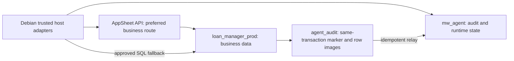

# Schema and transaction design

**Proposed; not applied.** The SQL files are concrete DDL candidates, not registered Flyway migrations. No database, role, table, trigger, grant, service flag or runtime code was changed while preparing this design. See [governance](GOVERNANCE.md) for authority and [handover](HANDOVER.md) for execution order.

## Database topology

The two databases share the current Cloud SQL instance. A normal PostgreSQL connection accesses one database; transactions do not automatically cover both. The design uses a business-database outbox and idempotent relay instead of distributed two-phase commit, foreign-data wrappers or a cross-database extension. [PostgreSQL database/schema boundaries](https://www.postgresql.org/docs/18/ddl-schemas.html).

| Artifact | Connection / future owner | Purpose |
|---|---|---|
| [00_instance_bootstrap](ddl/00_instance_bootstrap.proposed.sql) | Administrative `postgres` database session | New database and five restricted role identities; no credentials |
| [01_audit_and_control](ddl/01_audit_and_control.proposed.sql) | `mw_agent`, `mw_agent_owner` | Two immutable audit tables, mutable operation/run/control tables, migration evidence |
| [02_runtime_compatibility](ddl/02_runtime_compatibility.proposed.sql) | `mw_agent`, `mw_agent_owner` | Twenty compatibility tables, durable ingress work, frozen statement snapshots, indexes/grants |
| [03_business_outbox](ddl/03_business_outbox.proposed.sql) | `loan_manager_dev` then `loan_manager_prod` | Transaction audit schema/tables/functions and ten additive row-capture triggers |
| [04_business_privileges](ddl/04_business_privileges.proposed.sql) | Each verified business database | Separately managed audit access and scoped reviewer DELETE grants |

All files have an accidental-execution guard. The future operator must explicitly acknowledge `mw_design.execution_approved='agent-postgresql-20260922-v1'` in the same session after receiving an execution instruction. This setting does not itself grant authority and is never model-accessible. Database creation must be outside a transaction; the other candidates are transaction wrapped. When integrating into Flyway, use its transaction convention consistently rather than blindly nesting wrappers.

Owner membership is reserved for the administrative migration principal; runtime identities receive object privileges only. Membership and ownership semantics follow [PostgreSQL GRANT](https://www.postgresql.org/docs/18/sql-grant.html). Verify effective grants in the actual Cloud SQL administrative context before deployment. AppSheet route discovery uses the owning app's supported [API operations](https://support.google.com/appsheet/answer/10105398?hl=en) and actual table permissions; a supported transport verb alone does not prove an individual operation is permitted.

## Central audit and control

| Table | Key / role | Important behavior |
|---|---|---|
| `audit.operations` | UUID PK; unique service + idempotency key | Immutable logical intent, request/actor/auth/plan/code/policy evidence; parent operation groups workflow |
| `audit.events` | UUID PK; unique operation + ordinal | Append-only observations and lifecycle events; target keys, route, payload digest |
| `runtime.operation_state` | FK operation UUID | Mutable state, blocking scope and next event ordinal; update atomically with events |
| `runtime.service_control` | Service name | Backend/generation switches and migration boundary; deployment-controlled, worker read-only |
| `runtime.job_runs` | Run UUID, FK operation | Start/end/outcome per scheduled/manual run |
| `migration.batches` | Batch UUID | Import provenance, code version, verification/activation state; no ordinary worker writes |
| `migration.table_checks` | Batch + source file + source table | Presence, row totals, canonical hashes, status counts and exceptions |

New generic structures use `timestamptz`; input times have explicit offsets, persistence is UTC, presentation may be Bangkok. Treat monetary values in audit JSON as exact decimal strings with currency; never convert money through binary floating point. Generic `action` categories are transport verbs/events, not business-operation scripts. Event kinds are versioned in host code rather than requiring DDL for every new service.

The minimum event vocabulary is `requested`, `authorized`, `route_selected`, `dispatch_started`, `read_observed`, `row_changed`, `business_committed`, `provider_accepted`, `verified`, `completed`, `denied`, `failed`, `unknown`, `rolled_back`, `reconciled`, `legacy_imported`, `cutover` and `configuration_changed`. A scheduled run may be a parent with child tool/send operations. Never create fake historical timestamps or approval evidence during import.

The application allocates an event ordinal by locking that operation's state row, inserting the event and updating `next_event_seq` in one transaction. Do not lock all operations behind a global counter. Every event ID is stable across retries; on conflict compare canonical immutable values, excluding database-generated recording timestamps. Duplicate mismatches stop reconciliation. Payload hashes are integrity checks, not signatures against a malicious database administrator. `writer_role` records the database principal; caller/reviewer evidence remains a trusted-host assertion, not user-supplied metadata.

`operation_state.last_event_id` must belong to the same operation; the host validates this in the same transaction (the DDL FK alone establishes event existence). New state transitions are checked in the storage adapter with tests; do not let model-selected data modify operation state. FAILED means no external effect was dispatched or definite failure is established; use UNKNOWN for ambiguity. Existing per-service guards and the conversation-wide unknown-write block remain in force.

## Runtime compatibility, not a lossy normalization

The [machine-readable mapping](sqlite-mapping.json) identifies every current production application-owned SQLite table and the three lazy tables defined in source. The baseline at source `acbc0eb1c3544ec14ddf597ab59b614de8c3814d` is **six files, 18 present table instances, 351 rows**. Counts are a dated sizing observation, not the import manifest. Re-inventory after freezing writers. There are 21 possible source-table instances mapped into 20 compatibility tables because notices share a target with a stream discriminator.

| Source file | Target mapping |
|---|---|
| `instagram-ingress.db` | `receipts` → `runtime.ingress_receipts`; `messages` → `runtime.ingress_messages` |
| `receipt-processing.db` | Nine same-named runtime tables: cursor, jobs, keys, emails, reviews, replies, poll state/messages, reconsiderations |
| `partner-conversations.db` | `conversations` unchanged; `turns` → `conversation_turns`; `tool_calls` → `conversation_tool_calls`; optional operations/DML/fingerprints unchanged |
| `partner-notices.db` | `runtime.partner_notices`, `stream='receipt'` |
| `conversation-notices.db` | `runtime.partner_notices`, `stream='conversation'` |
| `cash-statement-delivery.db` | Same-named `cash_statement_sends` / `cash_statement_emails` runtime tables |

Preserve legacy serialized JSON as **TEXT**, not JSONB, in the compatibility tables. Existing code hashes and compares exact serialized strings, including proposal and email snapshots. Keep original text, whitespace, string numbers, NULL/empty-string distinction and Unicode; separately parse only for new audit summaries. Epoch REAL values map to PostgreSQL `double precision` with their original IEEE-754 value. Receipt image BLOBs map to `bytea`. New audit tables use structured JSONB independently. This exception avoids an unnecessary simultaneous business-state normalization.

Preserve existing status strings without inventing a new status for historical records. A new unknown/unrecognized status must be held, not made eligible by a permissive default. Do not regenerate IDs, reset attempts, extend review expiries or clear fingerprints. `partner_reviews.job_id` can contain an intentionally suffixed superseded ID, and ignored conversation turns can have an empty binding. Blanket foreign keys on these legacy historical identifiers would reject valid source rows; those FKs are deliberately absent. New work/control tables use actual relational keys.

Notice IDs are preserved but the PostgreSQL primary key is `(stream,id)`; every query, claim, retry and correlation must carry stream. Receipt review must only match receipt notices. Preserve `recipient_id`, partner snapshot and IG/email terminal status so a preference change cannot reopen accepted/unknown sends.

### Ingress cursor replacement

`ReceiptJournal.ingest()` currently advances using SQLite's hidden `messages.rowid`. Import that value as `legacy_rowid`; preserve `receipt_cursor.value` as historical evidence. Do **not** replace this with `WHERE ingress_seq > last_seen`: PostgreSQL sequences allocate outside transaction rollback and concurrent transactions can commit out of order. [Sequence semantics](https://www.postgresql.org/docs/18/functions-sequence.html).

Use `runtime.ingress_work` as the pending-message queue. New signed webhook intake inserts inbox, pending work and a central ingress event in one transaction before returning 200. Duplicate messages use their existing IDs and do not recreate completed work. Receipt ingestion claims pending work under row lock, derives the existing attachment job IDs, inserts jobs `ON CONFLICT DO NOTHING` with content verification, and marks work DONE/IGNORED in the same transaction. A crash before this commit simply rolls back the claim; this step has no external effect. Never hold the work-row lock while extracting images or calling the model/provider.

At import, bootstrap work only from records genuinely unconsumed according to the frozen source cursor, applicable original cutoffs and existing job reservations. Audit all boundary classifications. Previously terminal jobs remain terminal; queued work must retain its age/expiry checks. Poll-sourced receipt messages remain in their separate provenance tables and never become signed-webhook evidence or reviewer authority.

### Non-SQLite state

`runtime.statement_snapshots` can hold the exact frozen `snapshot.json` bytes as TEXT plus their digest and period metadata. Import these snapshots separately and keep the original files/PNGs under backup; do not regenerate an already-used statement from current balances. Retained receipt candidates/extraction evidence, configuration, credentials and systemd files likewise need their existing private backup paths.

The host's `conversations.binding → thread_id` mapping moves; Codex's own session/authentication files and its internally managed SQLite databases do not. Keep the existing private `partner-conversations/<binding>/` directories intact. Synthetic verification databases under `conversation-verification` and `reviewer-conversation-verification` are not production business state. Inventory/classify unexpected `.db` files; never silently drop an application journal.

## Business transaction audit

| Table | Purpose |
|---|---|
| `agent_audit.commits` | One operation UUID and one local transaction ID; immutable reviewer/plan/reason/targets snapshot |
| `agent_audit.row_changes` | Actual INSERT/UPDATE/DELETE old/new row images, including instrumented trigger effects, tied to that same transaction |
| `agent_audit.exports` | Append-only acknowledgement that central events were committed, keyed by operation UUID |

The host uses a **dedicated `mw_reviewer_dml` login**, not `SET ROLE` inside an administrator connection. `begin_operation()` is a fixed instrumentation call made by host code, not a model-selectable arbitrary function. It inserts the marker and sets an audit correlation variable local to the transaction. Capture triggers reject DML under this login without a valid marker matching the same `xid8`. Model input cannot set this variable. No business guard or replication-role setting is changed.

The ten initial capture tables are the nine existing DML resources plus trigger-owned Payment Allocations. AFTER ROW capture sees the row change after BEFORE-trigger modifications; cascades on instrumented tables are captured by their own row triggers. A sequence of changes to one row yields several events, not a claim that each intermediate image is its final state. Deferred business triggers must be flushed and final rows verified before commit. [PostgreSQL trigger behavior](https://www.postgresql.org/docs/18/sql-createtrigger.html).

Dependency coverage is a release prerequisite, not an assumption: inspect current FK actions and trigger function calls across both apps' shared tables. If a delete/update can affect an additional persistent table, instrument it or reject that path before enabling it. Do not disable existing triggers to make the audit tests pass. Zero-row statements still have an operation record; expected row-count checks determine whether they are a valid no-op or a rollback.

The outbox owner is NOLOGIN. SECURITY DEFINER functions have a fixed `pg_catalog` search path and fully qualified relation names, PUBLIC execution is revoked in the creation transaction, and the model's role cannot write captured images or rewrite markers directly. The worker receives only the fixed begin function and readback permissions. The relay may read the outbox and insert export acknowledgements; it cannot mutate business rows or delete audit. [PostgreSQL security-definer guidance](https://www.postgresql.org/docs/18/sql-createfunction.html).

### SQL mutation protocol

1. Discover API capability first, resolve the approved exact keys/consequences and record the SQL fallback reason. Check current reviewer authority; build an immutable logical plan and digest.
2. In `mw_agent`, atomically reserve legacy/new idempotency keys, intent, authorization/route/dispatch events and UNKNOWN/DISPATCHING projections; commit **before** connecting for the mutation.
3. In a separate business connection, `BEGIN ISOLATION LEVEL SERIALIZABLE READ WRITE`; set only fixed host timeouts/search path/time zone. Call `agent_audit.begin_operation()` with the central operation UUID and plan snapshot.
4. Lock exact target rows; compare their complete observed state. Execute parameterized INSERT/UPDATE/DELETE primitives selected by Codex. Never pass raw model SQL, expressions, relation names outside the resource boundary or session controls.
5. `SET CONSTRAINTS ALL IMMEDIATE`; read actual `row_changes` for this operation. Compare every actual DELETE key with the approved manifest; enforce effect/image limits and complete audit coverage. Verify surviving expected final values and absence of deleted targets. Recheck live reviewer authority using the existing fresh authorization path, then commit once.
6. Lost COMMIT acknowledgement remains UNKNOWN. A separate visible marker with matching plan/transaction/actor, plus recorded row effects, can establish commit; verify the business result before claiming success. Absence while the original connection may be alive is not proof of failure. No mutation retry.
7. Relay each captured row as a deterministic central `row_changed` event, then a final `business_committed` event and runtime projection in one central transaction. Only after that commit insert the business `exports` acknowledgement. A crash between these two commits re-exports identical event IDs; compare content and append no duplicates. Query unexported markers with `NOT EXISTS(exports)`, not a sequence watermark.

The marker is inserted at the **start**, not after `SET CONSTRAINTS`: this allows the row-change FK to validate immediately while existing deferred rollup triggers still run. The marker only becomes externally visible on successful business commit. Its timestamp is when it was recorded inside the transaction, not the exact commit time. The relay does not turn COMMITTED into VERIFIED without required readback/workflow evidence.

### API mutation and attribution limit

The host writes the same central intent/dispatch events before API execution, preserves explicit before-images, calls the owning API with the trusted actor, and records response/readback afterward. AppSheet's shared database login cannot receive this host transaction-local correlation value through the standard API. Accordingly the source capture triggers do not falsely label all AppSheet writes as agent DML. API audit proves the request, provider response and observed results; it does not prove exhaustive atomic capture of every asynchronous app effect. Record `coverage='observed_not_atomic'` where appropriate. This is why a dependent/cascading delete can require SQL fallback for the approved atomic target-set guarantee.

Existing persistent sessions cannot replace dynamic-tool schemas in installed App Server 0.155.1. Keep the established `app='database'` aliases. For new API DELETE support, add a strictly typed alias through the existing `api_action` schema: `app='appsheet_delete'`, `action='Edit'` as the legacy carrier, actual table/key, `row_json='{"owning_app":"oltp"}'` (or `olap`), empty expected-final object, stable operation key, current observation and instruction quote. The host maps this **only** to a single-key API Delete after the same approval, snapshot, dependency and API-permission checks. It must never treat it as an Edit. New sessions may expose a plainly named Delete tool. Test a real resumed synthetic session; do not erase/rebind existing threads to change tool schemas.

## Performance and storage

The current 351-row inventory supports a simple unpartitioned design. It is not a measurement of total image/file size or future event rate. Exact before/after images, inbound text and new per-tool events can grow faster than legacy queues; benchmark row-image volumes and monitor disk growth. Audit consistency outranks avoiding one critical persistence round trip. Central event/state commits can batch events for one action; provider/model calls stay outside SQL transactions. Use bounded connection pools and backpressure as in [Cloud SQL connection guidance](https://docs.cloud.google.com/sql/docs/postgres/manage-connections).

No new database extensions, object storage service, message broker or infrastructure resize is required by this initial design. These are separate future decisions if measured limits justify them.
