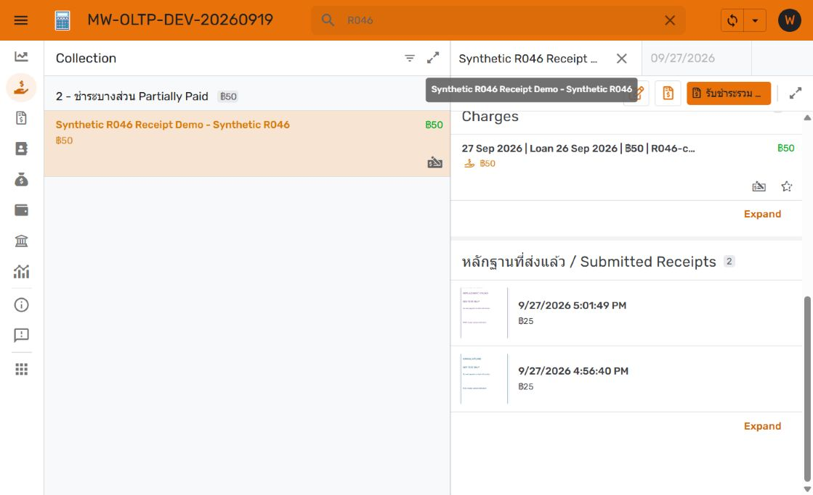
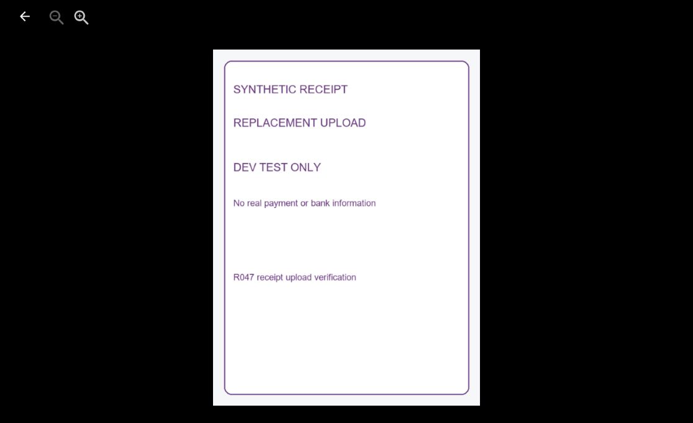

# R047 — Manual Payment receipt upload

27 September 2026. **DEV implementation and desktop end-to-end verification complete; ready for owner review.** R047 remains Open. Owner requested receipt upload in both create and edit Payment windows. No production changes in this component.

## Receipt ownership

The private bucket is shared: `mw-payment-receipts-prod-508610-n7`. AppSheet uses the existing `MW Receipt Images DEV` Payments object-store binding. No additional bucket, display copy, IAM exception or VM change is required by this design.

Agent-handled receipts retain their `mw_agent.receipt_assets` and `receipt_payment_links` catalogue and protected Payments projection (`IG Receipt ID`, `Receipt Image`, `Receipt Received At`). These describe agent intake, processing and linkage. Manual AppSheet uploads are linked directly to the existing Payment through `Uploaded Receipt`; they do not create agent/message records, trigger OCR, request another approval or automatically create another Payment. The agent database is therefore **not an inventory of every receipt object in GCS**. Any future inventory/cleanup process must consult both sources and must not classify manual objects as orphaned merely because they are absent from `receipt_assets`.

One current manual image is supported per Payment. Replacing/removing it changes the Payment reference; there is no user-facing attachment history or multi-image list. Agent originals remain independent and protected. No automatic GCS object deletion was added. AppSheet reads the stored manual image directly; there is no separate application display-copy pipeline. Native AppSheet upload processing changed the PNG bytes compared with the local fixtures (verified GCS MD5 differs), so this route does not promise byte-for-byte preservation of the selected source file. Agent-original preservation remains independent.

## Applied DEV changes

Target: instance `appsheet-pg-prod-20260914`, host `34.21.174.215:5432`, database **loan_manager_dev**.

| Asset | Rollback baseline | Current checkpoint |
| --- | --- | --- |
| OLTP `500b27b6-884a-41e8-a9ec-df801b0110ad` | 1.000109 | 1.000111; saved, Deployed, no editor issues |
| OLAP `9f3422be-bc87-4a5a-a42a-67528ee80393` | 1.000039 | 1.000041; saved, Deployed, no editor issues |
| DEV PostgreSQL | V51, verified private backup | V52, Flyway validation passed |
| Git | `1b8081f272c900f413151c4b8e9ba0c3721797f7` | See published checkpoint commit |

[V52](../../database/migrations/V52__manual_payment_receipt_upload.sql), SHA-256 `9f2235b3993ee1ba7cb2d4705d59d2bdea4f0027023fb1f3397d82621702de90`, adds nullable text `Uploaded Receipt` and nullable timestamp without time zone `Uploaded Receipt At`. A BEFORE INSERT/UPDATE trigger `a01_receipt_upload_stamp` calls `payment_receipt_upload_stamp()`: blank paths become NULL; a new/replaced path receives current Bangkok time; unchanged paths retain their prior timestamp; removal clears it. This is upload time, not bank transfer time. Applied migration bytes are immutable.

OLTP physical image field is optional, editable on create and edit, nonsearchable, marked sensitive, and has folder expression `"manual-receipts/dev"`. It appears in forms and when nonblank elsewhere. Timestamp is read-only, without a client initial value, and appears only outside forms when an upload exists. Explicit Payments_Form and Receive Selected Charges_Form orders include the image; Payments_Detail includes both image and timestamp while retaining agent evidence.

Two virtual fields unify Collection display:

```text
Receipt Preview (Image):
IF(ISNOTBLANK([Uploaded Receipt]), [Uploaded Receipt], [Receipt Image])

Receipt Display At (DateTime):
IF(ISNOTBLANK([Uploaded Receipt]), [Uploaded Receipt At], [Receipt Received At])

Submitted Receipt Payments filter:
AND([Status] = "Posted", OR(ISNOTBLANK([Receipt Image]), ISNOTBLANK([Uploaded Receipt])))
```

Both virtuals are shown only outside forms when either image exists. The slice remains read-only and includes the new fields. Submitted Receipts_Inline uses Receipt Preview and Receipt Display At descending, with Amount Received below it and the existing canonical Payment-detail navigation. If both sources exist, the manual upload supplies the thumbnail; Payment detail retains both originals. Existing borrower REF_ROWS relationship and empty-section hiding remain.

OLAP Payments was regenerated. Both new fields are hidden, noneditable and nonsearchable; image type is Image and sensitive, timestamp DateTime with no initial formula. OLAP stays read-only. Existing financial posting, selected-charge receiving, notifications, reporting and agent/audit relay code are unchanged.

AppSheet's native object-store mechanism writes image files and stores their reference in the column ([official documentation](https://support.google.com/appsheet/answer/10106769?hl=en)). The native path is now verified. For the existing test Payment, SQL stores `manual-receipts/dev/R046-payment.Uploaded Receipt.095636.png`, while GCS stores `appsheet/data/MW_OLTP_DEV_20260919_578763613/manual_receipts/dev/R046_payment.Uploaded_Receipt.095636.png`. AppSheet adds its app folder and normalizes spaces/hyphens to underscores. Preserve the native SQL reference; do not replace it with the normalized object key. [GCS metadata evidence](gcs-verification.json) records all three test objects, sizes, content types, generations and hashes. The first two uploads of the same fixture have identical stored MD5; replacement has a different MD5. Full-size rendering verified their content.

The timestamp is maintained by SQL and can require the next data sync to appear after save. A fresh sync populated it and updated Collection sorting. Existing app sessions may need a reload to acquire the new app definition; subsequent uploads use normal Save/Sync.

## Verification and remaining work

- [Backup and restore rehearsal](development-backup.json) verified all existing row fingerprints and no V52 backfill changes. Backup is private; repository evidence is metadata only.
- [Database CI](ci.txt) passed, including insert/replace/remove timestamp behavior, unchanged financial rows/children, existing receiving methods and transaction/concurrency checks.
- [Agent compatibility test](agent-compatibility.txt) passed with a manual image already on the synthetic Payment before agent attachment; attachment/retry/protected metadata checks passed.
- DEV V52 migration and [Flyway validation](dev-validate.json) passed (53 validated migrations).
- Desktop GUI upload/save/sync passed on existing agent-backed `R046-payment`; [edit reconciliation](gui-after-edit.json) proves every other Payment field and every allocation, repayment and cash entry stayed unchanged.
- Created one synthetic manual-only Payment `YpbLleCs6kW3gt6sAIVZIa`, amount 25, against R046-borrower and Synthetic R046 Dad account. It posted with one allocation, one repayment and one cash entry. Collection moved from 25 collected/75 remaining to 50/50. [Creation snapshot](gui-after-create.json).
- Replaced its image through Payment edit. Path and server timestamp advanced; all other Payment fields and child rows had identical before/after digests, with no additional rows. [Reconciliation](gui-after-replace.json).
- Collection shows both mixed-source and manual-only cards in descending upload-time order; both open canonical Payment detail. Manual upload and replacement full-size content were visually verified. The agent-backed Payment retains its original agent reference and independent image.
- All three actual objects were found in the existing private bucket. No permission or bucket changes were made. Old replacement objects remain retained by design.
- OLAP loaded/synced the new synthetic Payment and its allocation/repayment/cash entry; no Edit action and no manual receipt fields are exposed. Both saved editor versions remain 1.000111/1.000041 with **No issues found**.

The owner enabled the work-profile ChatGPT extension file-access setting and removed the earlier automation blocker. This is not an AppSheet end-user requirement. Phone-camera capture has not been tested; desktop file selection, creation, edit and replacement are verified. The optional control in Receive Selected Charges was verified; its financial workflow regression is covered by the prior selected-charge GUI tests and current SQL CI, not a second new selected-charge transaction in this upload test.

Synthetic records and three non-sensitive GCS objects are retained for owner review. No real borrower or PROD financial data was modified.





## Recovery and promotion

Restore the affected AppSheet baseline versions if needed; retain compatible nullable SQL columns while correcting forward. Restoring an app does not undo uploaded objects or financial writes. Full DEV DB restore requires accounting for later shared development. The [backup evidence](development-backup.json) records the private dump and verified restore hash.

PROD remains V50; agent runtime/catalogue, GCS permissions and PROD apps are untouched. This feature is **ready for owner DEV review**. Production authorization and integrated RC preparation/validation remain pending. Integrated promotion must include outstanding R046 receipt UI, R047 selected-charge and manual-upload changes, apply the exact compatible V51/V52 migrations before RC binding checks, and follow the single master promotion checklist. Replace the DEV upload-folder expression with the chosen PROD folder during RC preparation and verify its native storage path; do not modify ordinary DEV to achieve that substitution. No RC or final release tag has been created.
