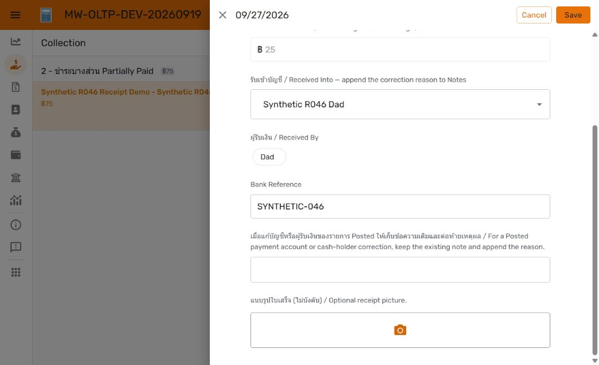

# R047 — Manual Payment receipt upload

27 September 2026. **DEV configuration applied; end-to-end upload verification pending.** R047 remains Open. Owner requested receipt upload in both create and edit Payment windows. No production changes in this component.

## Receipt ownership

The private bucket is shared: `mw-payment-receipts-prod-508610-n7`. AppSheet uses the existing `MW Receipt Images DEV` Payments object-store binding. No additional bucket, display copy, IAM exception or VM change is required by this design.

Agent-handled receipts retain their `mw_agent.receipt_assets` and `receipt_payment_links` catalogue and protected Payments projection (`IG Receipt ID`, `Receipt Image`, `Receipt Received At`). These describe agent intake, processing and linkage. Manual AppSheet uploads are linked directly to the existing Payment through `Uploaded Receipt`; they do not create agent/message records, trigger OCR, request another approval or automatically create another Payment. The agent database is therefore **not an inventory of every receipt object in GCS**. Any future inventory/cleanup process must consult both sources and must not classify manual objects as orphaned merely because they are absent from `receipt_assets`.

One current manual image is supported per Payment. Replacing/removing it changes the Payment reference; there is no user-facing attachment history or multi-image list. Agent originals remain independent and protected. No automatic GCS object deletion was added. The same image bytes are used for AppSheet viewing; there is no separate application display-copy pipeline.

## Applied DEV changes

Target: instance `appsheet-pg-prod-20260914`, host `34.21.174.215:5432`, database **loan_manager_dev**.

| Asset | Rollback baseline | Current checkpoint |
| --- | --- | --- |
| OLTP `500b27b6-884a-41e8-a9ec-df801b0110ad` | 1.000109 | 1.000111; saved, Deployed, no editor issues |
| OLAP `9f3422be-bc87-4a5a-a42a-67528ee80393` | 1.000039 | 1.000041; saved, Deployed, no editor issues |
| DEV PostgreSQL | V51, verified private backup | V52, Flyway validation passed |
| Git | `1b8081f272c900f413151c4b8e9ba0c3721797f7` | See published checkpoint commit |

[V52](../../database/migrations/V52__manual_payment_receipt_upload.sql), SHA-256 `9f2235b3993ee1ba7cb2d4705d59d2bdea4f0027023fb1f3397d82621702de90`, adds nullable text `Uploaded Receipt` and nullable timestamp without time zone `Uploaded Receipt At`. A BEFORE INSERT/UPDATE trigger `a01_receipt_upload_stamp` calls `payment_receipt_upload_stamp()`: blank paths become NULL; a new/replaced path receives current Bangkok time; unchanged paths retain their prior timestamp; removal clears it. This is upload time, not bank transfer time. Applied migration bytes are immutable.

OLTP physical image field is optional, editable on create and edit, nonsearchable, marked sensitive, and has folder expression `"manual-receipts/dev"`. It appears in forms and when nonblank elsewhere. Timestamp is read-only, without a client initial value, and appears only outside forms when an upload exists. Explicit Payments_Form and Receive Selected Charges_Form orders include the image; Payments_Detail includes both image and timestamp while retaining agent evidence.

Two virtual fields unify Collection display:

```text
Receipt Preview (Image):
IF(ISNOTBLANK([Uploaded Receipt]), [Uploaded Receipt], [Receipt Image])

Receipt Display At (DateTime):
IF(ISNOTBLANK([Uploaded Receipt]), [Uploaded Receipt At], [Receipt Received At])

Submitted Receipt Payments filter:
AND([Status] = "Posted", OR(ISNOTBLANK([Receipt Image]), ISNOTBLANK([Uploaded Receipt])))
```

Both virtuals are shown only outside forms when either image exists. The slice remains read-only and includes the new fields. Submitted Receipts_Inline uses Receipt Preview and Receipt Display At descending, with Amount Received below it and the existing canonical Payment-detail navigation. If both sources exist, the manual upload supplies the thumbnail; Payment detail retains both originals. Existing borrower REF_ROWS relationship and empty-section hiding remain.

OLAP Payments was regenerated. Both new fields are hidden, noneditable and nonsearchable; image type is Image and sensitive, timestamp DateTime with no initial formula. OLAP stays read-only. Existing financial posting, selected-charge receiving, notifications, reporting and agent/audit relay code are unchanged.

AppSheet's native object-store mechanism writes image files and stores their reference in the column ([official documentation](https://support.google.com/appsheet/answer/10106769?hl=en)). The configured folder is **not yet a verified final GCS object key**: native create/edit upload testing must establish the saved path and actual object location, including any AppSheet prefix. Do not hard-code an assumed path in integrations.

## Verification and remaining work

- [Backup and restore rehearsal](development-backup.json) verified all existing row fingerprints and no V52 backfill changes. Backup is private; repository evidence is metadata only.
- [Database CI](ci.txt) passed, including insert/replace/remove timestamp behavior, unchanged financial rows/children, existing receiving methods and transaction/concurrency checks.
- [Agent compatibility test](agent-compatibility.txt) passed with a manual image already on the synthetic Payment before agent attachment; attachment/retry/protected metadata checks passed.
- DEV V52 migration and [Flyway validation](dev-validate.json) passed (53 validated migrations).
- Current desktop GUI showed optional upload in posted-Payment edit, ordinary new Payment and Receive Selected Charges forms. Forms were cancelled; no GUI financial writes or file uploads completed.
- Both saved editors report no issues. Existing synthetic agent receipt still appears in Collection and Payment detail.

**Blocking test setup:** Chrome ChatGPT browser extension in the `mw-credit.com` profile needs **Allow access to file URLs** enabled. The native chooser was reached, but `setFiles` was rejected by that extension setting. No successful storage write is claimed. This is an automation test prerequisite, not an AppSheet end-user requirement.

After enabled: upload `synthetic-upload.png` on `R046-payment`, save/sync and run `Verify-ReceiptUploadDev.py after-edit` to compare all other Payment fields and child rows against [baseline](gui-before.json). Then create a synthetic Payment with upload against R046-borrower, use the synthetic receiving account, reconcile posting, replace with `synthetic-replacement.png`, verify timestamp and no reposting, and inspect both manual-only and agent-backed receipt cards/full-size images. Verify actual objects in the existing bucket with the correct account, retaining private access. Recheck OLAP load/sync and affected read view. Record actual results and screenshots before claiming DEV completion. Phone-camera testing has not been performed.



## Recovery and promotion

Restore the affected AppSheet baseline versions if needed; retain compatible nullable SQL columns while correcting forward. Restoring an app does not undo uploaded objects or financial writes. Full DEV DB restore requires accounting for later shared development. The [backup evidence](development-backup.json) records the private dump and verified restore hash.

PROD remains V50; agent runtime/catalogue, GCS permissions and PROD apps are untouched. This feature is **not ready for promotion** until the pending GUI/GCS checks pass and owner review is complete. Integrated promotion must include outstanding R046 receipt UI, R047 selected-charge and manual-upload changes, apply the exact compatible V51/V52 migrations before RC binding checks, and follow the single master promotion checklist. Replace the DEV upload-folder expression with the chosen PROD folder during RC preparation and verify its native storage path; do not modify ordinary DEV to achieve that substitution. No RC or final release tag has been created.
