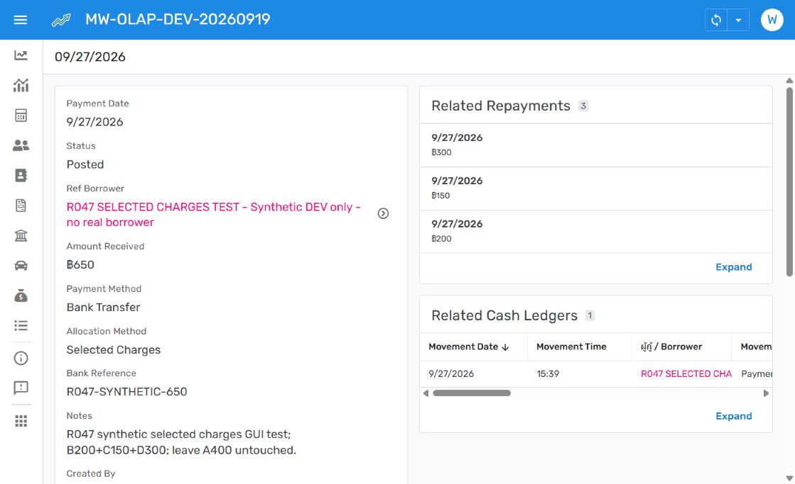
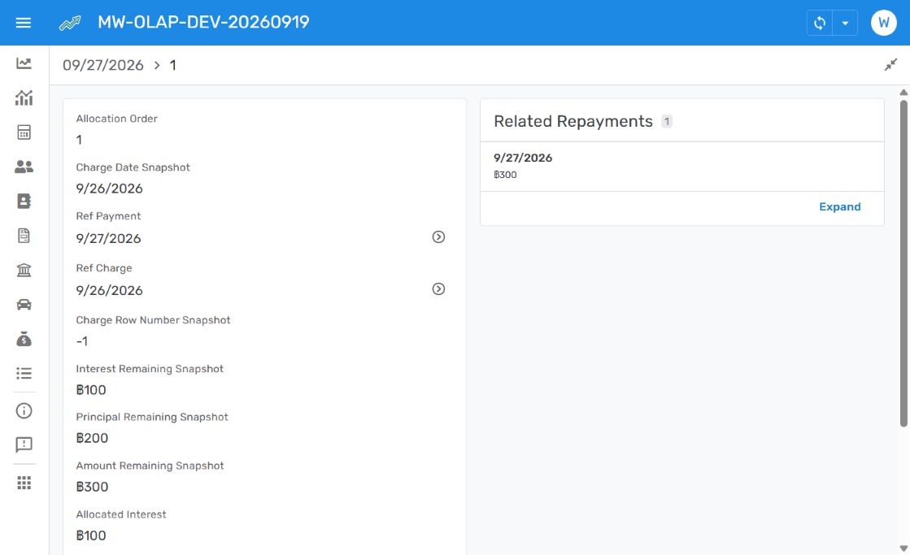

# R047 — OLAP whole-baht formatting

27 September 2026. Owner requested correction of the reported dollar symbols, then specified Thai baht with zero decimals for all seven affected fields. Implemented in DEV OLAP **1.000042**; restorable rollback **1.000041**. Git baseline 47b786bdfe75d9a8886e9bbf605465a3d5d6f748. R047 remains Open.

All seven were confirmed as Price fields using CurrencySymbol "$" and DecimalDigits 2. They now use CurrencySymbol "฿" and DecimalDigits 0:

| Table | Fields |
| --- | --- |
| Payments | Amount Received |
| Payment Allocations | Interest Remaining Snapshot; Principal Remaining Snapshot; Amount Remaining Snapshot; Allocated Interest; Allocated Principal; Allocated Amount |

No changes to stored amounts, types, formulas, permissions, SQL, source bindings or financial data. OLTP1.000116 remains unchanged. This resolves the previously disclosed payment/allocation dollar-format limitation in DEV; PROD remains unchanged until integrated promotion. This is the targeted seven-field correction, not a claim of a new whole-app audit.

Current GUI verified synthetic Payment gT5LsghHbQpeAAZvL98jKt displays ฿650, with all three allocation rows rendered in baht and no decimals. Opened allocation1 and verified all six fields: snapshots ฿100/฿200/฿300 and allocated values ฿100/฿200/฿300. Existing Repayments/cash entries agree. No record editing or payment posting occurred. Both final saved editors report No issues found.

Exact DEV dictionary overlays, integrated manifest, current version records and release log updated. Display-only work reuses existing financial tests; dictionary and whitespace checks precede normal publication. Restore OLAP1.000041 only after accounting for later changes if rollback is needed.
