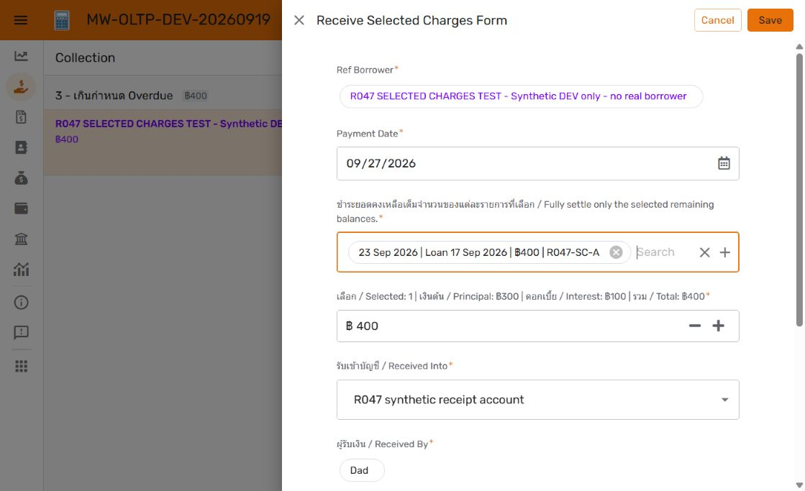

# R047 — Receive Selected Charges: DEV implementation

27 September 2026. **Implemented and verified in DEV; owner review and production promotion pending.** R047 remains Open. This component preserves the earlier Collection receipt section and depends on the unpromoted R046 receipt UI. [Original design](HANDOVER.md) is retained as dated proposal evidence.

## Use and behavior

In OLTP Collection, open a borrower and choose **รับชำระรายการที่เลือก / Receive Selected Charges**. Select charges in the dedicated multi-select form, review the count, principal, interest and combined remaining balance, select the receiving account and save one Payment. The borrower is fixed. Only that borrower's positive remaining charges dated on or before Payment Date qualify. Selected charges must be fully settled; the amount must exactly equal their combined residual. Unselected charges receive nothing. All six previous receiving methods remain available.

The form returns to Collection after saving, consistent with the existing receiving flow; open Payment detail to review posting. This is the implemented choice instead of the proposal's suggested automatic Payment-detail redirect. Selection is in the form, not checkboxes directly on the existing inline charge list.

Charges now use a visible virtual label containing charge date, loan date, current residual and charge key. This disambiguates same-date items and also changes OLTP Ref labels/automatic Collection card labels. Posted allocation snapshots remain the authority for historical paid amounts; a label's current balance can become zero.

## Saved identities and recovery

| Asset | Before / rollback | Verified DEV result |
| --- | --- | --- |
| OLTP `500b27b6-884a-41e8-a9ec-df801b0110ad` | 1.000098 | **1.000109**, Deployed, no editor issues |
| OLAP `9f3422be-bc87-4a5a-a42a-67528ee80393` | 1.000036 | **1.000039**, Deployed, no editor issues |
| PostgreSQL | V50; verified private dump and restore | **V51**, Flyway validation passed, 52 migrations |
| Git | `e587eeaf438aab925e5a7145d40593b24cdb1d5f` | This evidence commit; unrelated work preserved |

SQL target: instance `appsheet-pg-prod-20260914`, host `34.21.174.215:5432`, database **loan_manager_dev**. PROD remains V50; no PROD app or financial writes were performed. [Backup/rehearsal evidence](development-backup.json) records the private dump, hash and restoration verification. Restore app definitions independently of SQL/data: app rollback does not reverse posted receipts. Prefer compatible schema retention and a reviewed forward correction; any full DEV restore must account for later work. V51 must not be edited after application.

## Implementation contract

- [V51 migration](../../database/migrations/V51__selected_charge_receiving.sql) adds nullable text `Payments.Selected Charge IDs`, without backfilling prior receipts. Its SHA-256 is `9a0fd8fe55410e48fd231c830d297c2481aa98a2c25ee3147cbf96d953f46086`.
- `selected_charge_ids(text)` parses and canonicalizes unique charge keys; malformed/duplicate scopes fail. A BEFORE trigger guards method/scope consistency and immutability after posting or prepared children.
- `payment_charge_balances(text)` and `post_payment(text)` extend the existing engine for Selected Charges. Under the existing transaction/borrower locks, the engine rechecks every selected key, borrower, date and residual, requires exact amount equality and creates the existing allocations, Repayments and single receipt cash movement atomically. Existing allocation ordering is retained; no new ordering promise is introduced.
- OLTP adds the receiving action/form, Selected Charges enum choice, EnumList of Charge Refs, dynamic eligibility, exact amount validation/initial value, preview and posted-field locks. Serialization was proved by the real GUI save: `R047-SC-B , R047-SC-C , R047-SC-D`. Dynamic Valid_If and SQL enforce scope even though EnumList Allow other values is enabled.
- OLAP Payments was regenerated; the new selection field is hidden, noneditable and nonsearchable. Existing read-only payment/allocation/repayment/cash views work without new financial editing.
- No new posting bot, notification route, report definition, agent runtime or storage configuration. Existing SQL receipt insertion posts the payment. Affected reporting consumes existing receipt/allocation grain; no report schema redesign is required.

Exact AppSheet deltas and live SQL definitions are recorded in the [DEV dictionary](../../Documents/Data%20Dictionary/development/README.md). [Live SQL metadata](dev-metadata.json), [migration result](dev-migrate.json), [validation](dev-validate.json) and [development manifest](release-manifest.json) provide implementation evidence.

## Verification

The maintained CI runner passed twice; the final run includes competing selected-charge submissions. [CI output](ci.txt), [selected-charge assertions](../../scripts/database/Test-SelectedCharges.sql), and [concurrency runner](../../scripts/database/Test-CorePaymentConcurrency.ps1) cover exact settlement, partial residuals, all previous methods, malformed/duplicate/missing/foreign/future/paid selections, amount mismatch, immutable scope, transaction rollback, retry and concurrent stale-selection rejection.

Current AppSheet GUI checks passed:

| Check | Observed result |
| --- | --- |
| B200 + C150 residual + D300 | One Posted Payment650, three allocations/Repayments650, one cash movement650 |
| Unselected A400 and future F30 | Remain outstanding; future charge excluded from picker |
| Amount649 | Save blocked; no financial write |
| Subsequent picker | Paid B/C/D absent; only eligible A400 remains |
| A preview | Count1, principal300, interest100, total400; form cancelled |
| Backdate before all charges | No eligible selection; cancelled |
| Posted receipt edit | Borrower/date/method/selection/amount locked; cancelled |
| Existing Lump Sum / Single Partial | Correct original forms, outstanding/target values; cancelled |
| OLAP payment detail | Same receipt, three allocations, three Repayments, one cash entry; read-only |
| Both final editors | No warnings/errors; versions above |

[Reconciliation](dev-reconciliation.json) asserts the actual synthetic receipt `gT5LsghHbQpeAAZvL98jKt` and unchanged unselected balances. Test borrower/account names and references are synthetic. The [fixture retirement](fixture-retired.json) hides the borrower and deactivates its accounts while retaining auditable financial rows; these synthetic rows may remain in DEV analytics. No physical financial deletion was used.

Additional evidence: [posted OLTP payment](dev-posted-payment.png), [OLAP payment](dev-olap-payment.png), [OLTP editor](dev-oltp-editor.png), [OLAP editor](dev-olap-editor.png).

## Remaining scope and limitations

Owner acceptance and authorized integrated RC promotion remain pending. No RC, production checklist execution, scope freeze or final R047 tag was created. At promotion, capture all integrated R046/R047 AppSheet work, pin SQL/versions, apply compatible V51 before PROD-bound source verification, and follow the single master promotion checklist.

OLAP still displays a dollar symbol on some existing Payment/allocation amount fields, an earlier recorded R026 formatting limitation; numerical amounts and baht cash/repayment reconciliation are correct. This task does not claim that unrelated presentation issue is resolved. GUI verification used the current desktop interface; a separate phone-device layout test was not performed.
