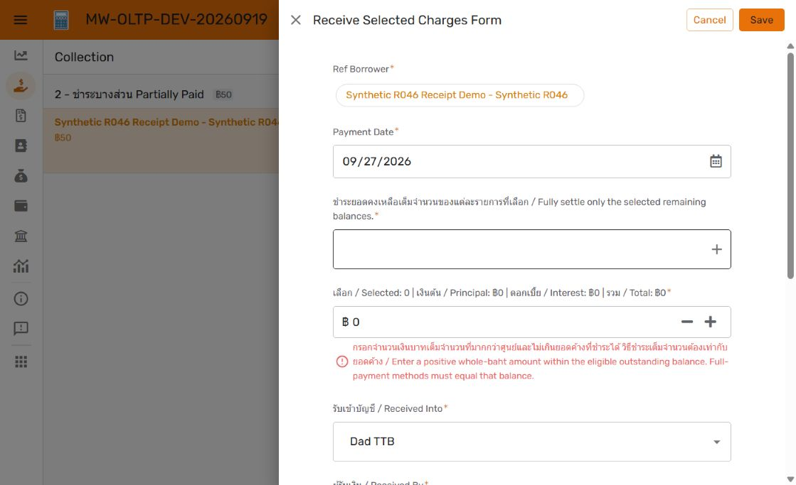
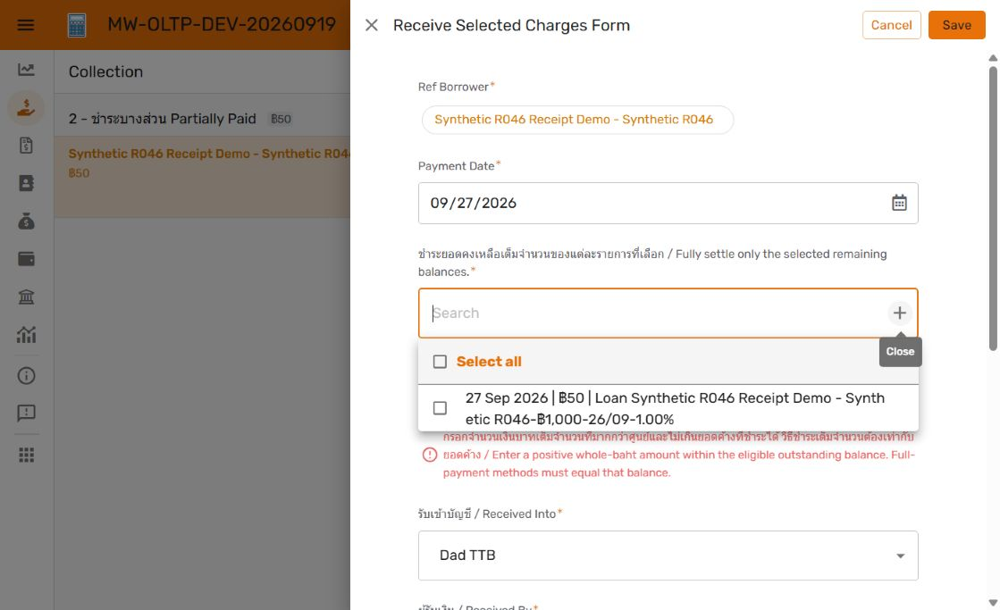

# R047 — Charge label refinement

## Loan Key interest display — DEV 1.000115

Owner subsequently requested no decimals in the Loan Key interest segment. DEV OLTP1.000115 replaces TEXT([Effective Daily Interest Rate]) with ROUND([Effective Daily Interest Rate] * 100) followed by "%". This rounds only the label to whole percentage points (1.00% → 1%); underlying rates and financial calculations retain full precision. Other Loan Key segments and the charge date | residual | Loan Key order are preserved. OLTP Loan Ref labels inherit the change; OLAP1.000041 remains unchanged.

Rollback is OLTP1.000114; starting Git 82dc65f36df691b147ffd5875ef87737e9a2d552. Current GUI verified the synthetic R046 charge card and selected-charge dropdown ending in 1%, then cancelled the form without saving. Both editors have no issues. Exact Loans dictionary overlay and current tracker/manifest/version records updated. No SQL/data/PROD change; R047 remains Open. Existing payment-engine tests remain applicable; this display-only refinement required no new financial transaction tests.



27 September 2026. Owner requested removal of the displayed charge Row ID and replacement of loan date with Loan Key. Implemented in DEV OLTP **1.000114**; restorable baseline **1.000112** was captured after refreshing the newer shared definition. Starting Git commit: e3881c75c8256d282a7c829a3a9182871a031ad3.

Owner further specified the display order: **charge date | remaining amount | Loan Key**. The intermediate 1.000113 was refined to 1.000114 within the same batch. Only Charges.Charge Selection Label changed:

```appsheet
CONCATENATE(TEXT([Charge Date], "DD MMM YYYY"), " | ฿", [Amount Remaining], " | Loan ", [Ref Loans].[Loan Key])
```

The underlying immutable charge IDs and payment selections are unchanged. Existing label/Show settings remain enabled. Loan Key uses the existing Loans virtual field. No SQL, financial record, notification, report or PROD change.

Verified the saved formula through successful editor validation and the rendered Collection charge card and Receive Selected Charges dropdown after sync/reload. The synthetic R046 record displays its full Loan Key and remaining ฿50; the charge row ID is absent. The test form was cancelled without saving. Both DEV editors report No issues found; OLAP1.000041 remains unchanged. No payment-engine regression rerun was needed for this display-only formula.



The earlier 1.000109 implementation evidence remains a dated checkpoint. Receipt-upload work subsequently advanced DEV to V52; this refinement preserves that work and the current action icon. R047 remains Open for review and integrated promotion. Dictionary, current version records and log are updated; unrelated untracked work is preserved.
