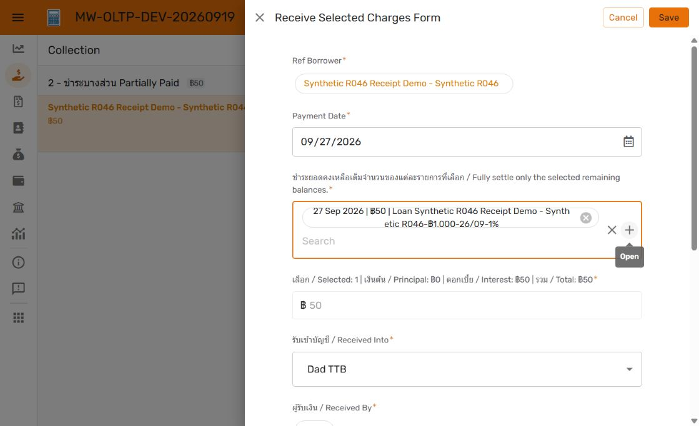

# R047 — Read-only selected-charge total

27 September 2026. Owner authorized making the amount read-only for Receive Selected Charges. Implemented in DEV OLTP **1.000116**, restorable rollback **1.000115**; Git baseline d01982b779d6bc6732fb88686b35a100ab2b5ab2.

Payments.Amount Received Editable_If changed from NOT(IN([Row ID], Payments[Row ID])) to:

```appsheet
AND(NOT(IN([Row ID], Payments[Row ID])), [Allocation Method] <> "Selected Charges")
```

The existing selection-based Initial value, exact-total Valid_If, posted receipt locks and SQL validation are retained. There is no App formula on this persisted field: other receiving methods retain their original amount entry. No SQL, financial data, notification, OLAP configuration or PROD change.

Current GUI verification with the synthetic R046 borrower passed:

- No selection: amount disabled at zero, with no increment/decrement controls.
- Select the remaining charge: disabled amount updates to ฿50 and summary shows one charge/฿50 interest.
- Clear selection: summary returns to zero and amount remains disabled.
- Lump Sum and Single Partial: amount remains an enabled numeric input.
- All forms cancelled/discarded; no payment saved.
- OLTP1.000116 and unchanged OLAP1.000041 editors report No issues found.



This is an editability refinement. Existing posting/regression evidence remains applicable; no new financial posting test was needed. Exact Payments dictionary, release log, current versions and manifest are updated. R047 remains Open; owner review and production promotion remain pending.
