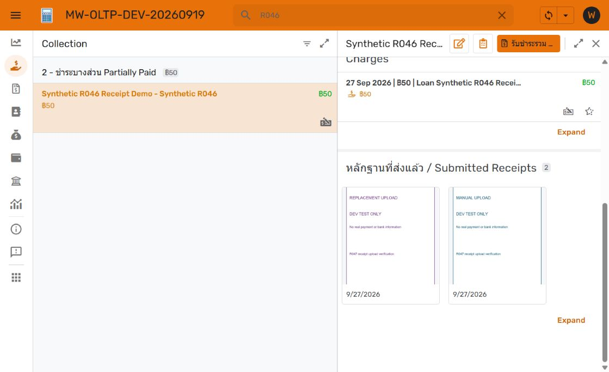
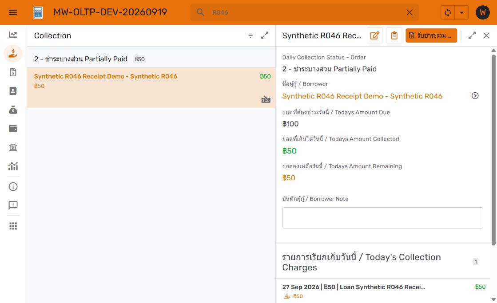

# R048 — Collection receipts follow displayed charges

27 September 2026. Implemented in DEV OLTP **1.000124**, pending owner review and production promotion. R048 remains Open. DEV OLAP **1.000042** is unchanged. PROD remains OLTP3.000252 / OLAP1.100205 / SQLV52.

## Behavior

Opening a borrower in Collection shows pictures only for Posted Payments with a positive allocation to at least one charge in that borrower's **Todays Collection Charges** list. Receipts belonging solely to other charges are excluded, even for the same borrower. The existing list determines charge eligibility; this feature does not independently redefine today's charges or impose a payment-date cutoff. An earlier partial payment remains visible while its charge is displayed. A payment spanning several displayed charges appears once.

The gallery accepts agent images and manual uploads. Its image now uses the existing **Receipt Preview** expression, preferring a manual upload and falling back to the original agent image. Empty lists remain hidden. No receipt file or Payment is deleted; full payment history remains available through Payments.

## Exact implementation

Target: `MW-OLTP-DEV-20260919-578763613`, app ID `500b27b6-884a-41e8-a9ec-df801b0110ad`, source `database-3`, database `loan_manager_dev` on `appsheet-pg-prod-20260914` / `34.21.174.215:5432`.

`Submitted Receipt Payments` remains a read-only slice of Payments. Its saved row filter is:

```appsheet
AND(
  [Status] = "Posted",
  OR(ISNOTBLANK([Receipt Image]), ISNOTBLANK([Uploaded Receipt])),
  COUNT(
    INTERSECT(
      SELECT([Related Payment Allocations][Ref Charge], [Allocated Amount] > 0),
      [Ref Borrower].[Todays Collection Charges]
    )
  ) > 0
)
```

Borrowers.Submitted Receipts retains `REF_ROWS("Submitted Receipt Payments", "Ref Borrower")`, its slice Ref type and existing nonempty/detail Show_If. Slice membership and gallery view configuration are unchanged. No new column, SQL migration, agent script, GCS object or permission change is required.

Payments.Receipt Preview **Label** changes from No to Yes. Its existing Image formula remains:

```appsheet
IF(ISNOTBLANK([Uploaded Receipt]), [Uploaded Receipt], [Receipt Image])
```

The current gallery previously defaulted to Receipt Image, leaving manual-only cards blank. Setting the image label selects the combined preview while preserving the owner's gallery layout. This is the table's image label, so automatic Payment/Ref/detail image presentation also uses the combined preview. The nonimage Payment Date label and original image fields remain available. [AppSheet row-label behavior](https://support.google.com/appsheet/answer/10106376?hl=en).

## Dependencies and verification

- Existing positive Payment Allocations link each Payment to Ref Charge; Borrowers.Todays Collection Charges is the same list rendered above the gallery. It does not depend on Submitted Receipts, so this introduces no circular reference.
- Read-only DEV SQL confirmed two existing synthetic image-bearing Payments, each with a positive allocation of 25 to the one displayed synthetic charge. No payment or allocation data was written for this work.
- Current DEV app loaded/synced: the synthetic borrower showed one charge and two receipt cards. Both manual/replacement test pictures rendered after the image-label correction; opening a card reached its read-only payment detail and allocation.
- Controlled GUI exclusion test: temporarily replaced only the scope operand with `LIST("R048-unrelated-charge")` in DEV version1.000123. With the same borrower, charge and receipts, the receipt section disappeared. Restored the final dynamic operand, saved **1.000124**, reloaded and confirmed both cards returned. The test literal is absent from the saved final formula. This proves exclusion with a controlled scope, not a seeded multi-charge financial workflow.
- Both DEV editors reported **No issues found**. Final OLTP saved version verified through Manage / Versions; no unsaved edits. No deployment-mode toggle or financial/notification test.
- Existing DEV fixtures both have manual previews; agent-only fallback follows the unchanged preview formula and prior R047 verification. No new agent-only or multi-charge financial fixture was created.





## Recovery and next step

Before the coherent change batch, restorable DEV OLTP **1.000118** was recorded; Git baseline `f505959e4e92ae482f8e951fce1c84d4c3bc80d4`. To reverse only this feature while preserving later work, restore the slice's former filter `AND([Status] = "Posted", OR(ISNOTBLANK([Receipt Image]), ISNOTBLANK([Uploaded Receipt])))` and set Receipt Preview Label back to No. Whole-app restore to1.000118 is available only after accounting for intervening changes. No database/file recovery is needed.

Ready for owner DEV review. Production promotion remains pending and requires the normal integrated RC/App Upgrade workflow for R048; no production update was performed. Exact DEV deltas are under `Documents/Data Dictionary/development/appsheet/r048/`.
