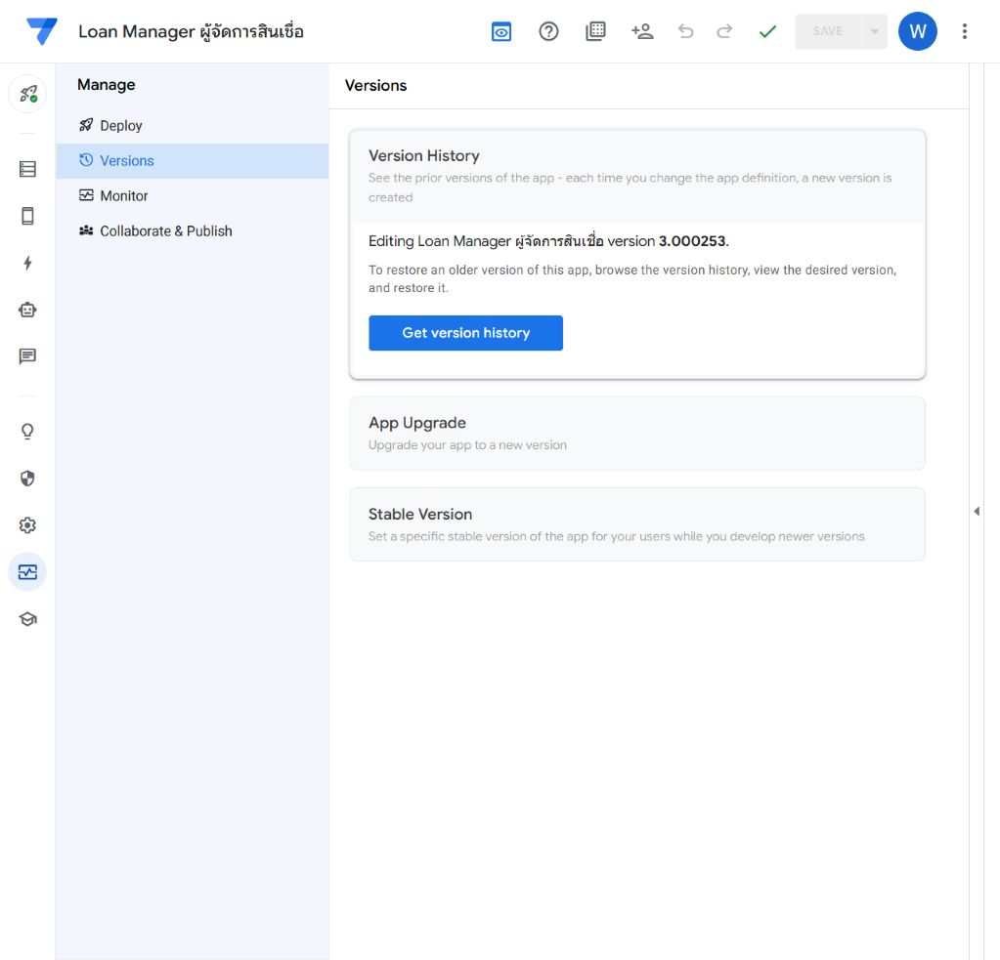

# Direct production correction — R048

27 September 2026. **Applied and verified** in canonical PROD OLTP `93844270-6aa5-420b-a960-bcdf08abd357` / `LoanManager-975338008-26-08-07`.

The owner explicitly requested the same two DEV changes directly in production and instructed us to skip the promotion process for this bug fix. This is a scoped exception: no RC, App Upgrade, release freeze/number handoff, promotion checklist or release tag was used. R048 remains the Open development release with this correction delivered. It does not establish a general exception for future changes.

## Exact before and after

- Restorable PROD baseline **3.000252** verified in Manage / Versions before editing. Both settings saved together as **3.000253**.
- Submitted Receipt Payments row filter: former `AND([Status] = "Posted", OR(ISNOTBLANK([Receipt Image]), ISNOTBLANK([Uploaded Receipt])))` replaced by the exact positive-allocation/displayed-charge intersection in [HANDOVER.md](HANDOVER.md#exact-implementation).
- Payments.Receipt Preview Label: **No → Yes**. Formula, gallery layout and nonimage label unchanged.
- Source remains `database-2`; no DB/schema/data, GCS, Debian agent/script, permission, notification or schedule mutation. PROD OLAP remains unchanged at recorded1.100205; DEV remains1.000124 /1.000042. SQLV52 is unchanged.

## Checks

1. Correct Chrome work profile and previously verified AppSheet account reused. Actual canonical PROD app ID/name verified; source `database-2` observed. Initial home listing and editor report Deployed.
2. Saved filter read back with the dynamic `[Ref Borrower].[Todays Collection Charges]` operand; saved Receipt Preview label checked. No test literal or temporary DEV exclusion probe was applied in PROD.
3. Final OLTP Manage / Versions reports **3.000253** with no unsaved changes. Both PROD editors report **No issues found**.
4. Canonical PROD app loaded with **Sync complete**. Collection opened; a representative paid borrower's detail showed its charges and one receipt card. The receipt image loaded successfully (natural size1194×1460). Borrower and bank details are omitted from published evidence.
5. Reused the DEV positive/exclusion and manual-image tests because these exact two settings and dependencies are unchanged. No production financial write or forced notification was performed.
6. DEV already contains this correction; no reconciliation blocker remains for the next normal integrated RC. Production dictionary and current references updated to match.

## Recovery

Targeted recovery restores the old slice condition above and Receipt Preview Label No. Whole-app version3.000252 is the recorded rollback point; review intervening changes before restoring an entire definition. No data/file recovery is needed. Git starting commit for this direct correction: `e47f9ab05ebb24afe71b0861d8b3562c9ecf410d`.
