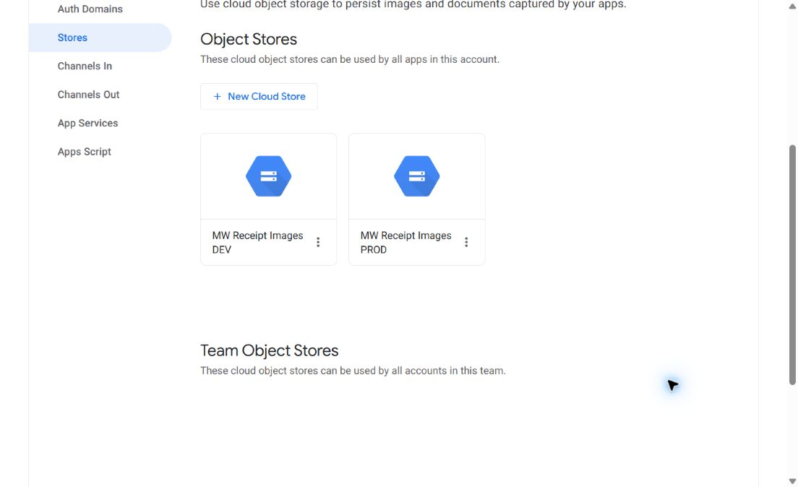

# AppSheet–GCS connection checkpoint

27 September 2026 — **DEV and PROD account object stores saved and tested; app table bindings and receipt rendering remain pending**.

## Implemented configuration

Owner approved the key-creation exception, then requested reasonable bucket-level access without fine-grained restrictions or repeated exceptions. This supersedes the earlier read-only/synthetic-prefix proposal.

| Setting | Actual value |
| --- | --- |
| AppSheet owner | `welct0407@mw-credit.com`, account `578763613`, Enterprise Plus |
| Object stores | `MW Receipt Images DEV`, `MW Receipt Images PROD` |
| Single bucket | `mw-payment-receipts-prod-508610-n7` |
| Project / organization | `clever-oasis-508610-n7` / `594773370606` |
| DEV service account | `appsheet-receipts-dev@clever-oasis-508610-n7.iam.gserviceaccount.com` |
| PROD service account | `appsheet-receipts-prod@clever-oasis-508610-n7.iam.gserviceaccount.com` |
| Both bucket grants | `roles/storage.objectUser` and `roles/storage.bucketViewer`, on this bucket only |
| Scope | Read/list/create/update/delete/restore objects and read bucket configuration; no bucket IAM administration through these grants |
| Filename normalization | Normalize GCS-unsupported characters (recommended) |
| Public access | Still prevented; uniform IAM retained; seven-day soft delete retained |

DEV and PROD credentials now have the same bucket-level capability. DEV is **not isolated from production receipt objects by IAM**. Test prefixes remain an organizational convention. The temporary custom `receiptImageReader` role and conditional DEV grant were removed; the unused custom role was soft-deleted. Existing project-derived bucket bindings were preserved.

## Standing, narrowly scoped key exception

Both `iam.disableServiceAccountKeyCreation` and `iam.managed.disableServiceAccountKeyCreation` have project-local policies with this rule:

- `resource.matchTagId('tagKeys/281481623778262', 'tagValues/281478530241526')`: enforcement false.
- All other resources: enforcement true.

The project-owned tag `clever-oasis-508610-n7/appsheetReceiptKeyException=allowed` is bound only to the two dedicated receipt service accounts (unique IDs PROD `100619300087139680910`, DEV `117618498801376993721`). It is not bound to the project, organization or other service accounts. Project effective policy readback remains enforced. Only the tagged identities can use the exception, and callers still need key-creation IAM permission. Future credential rotation does not require temporarily relaxing policies again.

Initially, organization-level tag creation was denied for missing `resourcemanager.tagKeys.create`. A project-owned tag was successfully created using the owner's existing project authority; no new administrative role was granted. The first temporary exceptions were removed after keys were created. Following the owner's simplification request, the same two-account exceptions were retained as standing exceptions. [Saved policies, tags and bucket IAM](connection-evidence/).

## Credential handling and recovery

Active private JSON files are outside Git:

- `C:\Users\MWCredit\Documents\ChatGPT\AppSheet-Loan-Project\receipt-storage\appsheet-receipts-dev.json`
- `C:\Users\MWCredit\Documents\ChatGPT\AppSheet-Loan-Project\receipt-storage\appsheet-receipts-prod-v2.json`

Keys are saved in AppSheet's object-store connection. Their contents are not included in repository evidence. Independent backup of these local files has **not** been verified. The standing exception supports replacement keys if necessary; it is not a credential backup.

The first PROD key was echoed by a browser-tool validation error while a multiline value was rejected. It was immediately disabled, replaced, then deleted from GCP and local disk. Its ID was `9a65d1f2865bbe3160bc1dbdee4596bdc40ff1b5`; it is not used by AppSheet. Subsequent form input used compact JSON, caught errors without printing details, and suppressed credential values in observations. Final key metadata confirms one user-managed key for each identity. Never reuse the deleted key.

## Verification and remaining app work

- AppSheet Test Connection displayed success for both stores; both appeared in the saved Object Stores list.
- Each actual service-account credential uploaded a synthetic text object and read back identical contents under `test/receipt-storage/connectivity-20260927/{dev,prod}.txt`. No business records or receipts were used. Two small synthetic probes are retained.
- The native current editors for canonical DEV OLTP `500b27b6-884a-41e8-a9ec-df801b0110ad` and PROD OLTP `93844270-6aa5-420b-a960-bcdf08abd357` both expose the two stores under Payments → Storage. Their sources remain `database-3` and `database-2`. Both table store selections remain **Default**, and Save was disabled on exit. DEV version observed `1.000092`; no app definition was modified.
- Stores belong to the shared owner account and are available to its apps, including OLAP; no separate account connection is required for each app. OLAP table bindings were not changed or independently inspected in this checkpoint.
- **This verifies account connectivity, not receipt rendering.** Table store selection, receipt Image fields, externally uploaded relative-path rendering, user access checks, agent capture and posting linkage remain part of feature implementation. Apply app-definition changes through the repository release workflow; do not infer activation from a green connector test.

## Rollback

Remove the saved object stores if abandoned, after checking consumers. Revoke their two bucket-role bindings and active keys if no longer used. To reinstate the previous key policy, remove the two owned project overrides with etag checks and detach their tag bindings; inherited enforcement is the recorded baseline. This does not revoke existing keys. Preserve unrelated inherited IAM and all receipt objects. The bucket itself and existing apps require no rollback from this account-only setup.

Starting Git commit: `4d360d4093edd67973e9c0ff20813dcb886658f7`. Unrelated working-tree files were preserved. No financial write, notification, database schema change, agent deployment or product release promotion occurred.

Official references: [AppSheet GCS configuration](https://support.google.com/appsheet/answer/10106382?hl=en), [service-account policy exceptions](https://docs.cloud.google.com/iam/docs/troubleshoot-org-policies), [GCS roles](https://docs.cloud.google.com/storage/docs/access-control/iam-roles).
