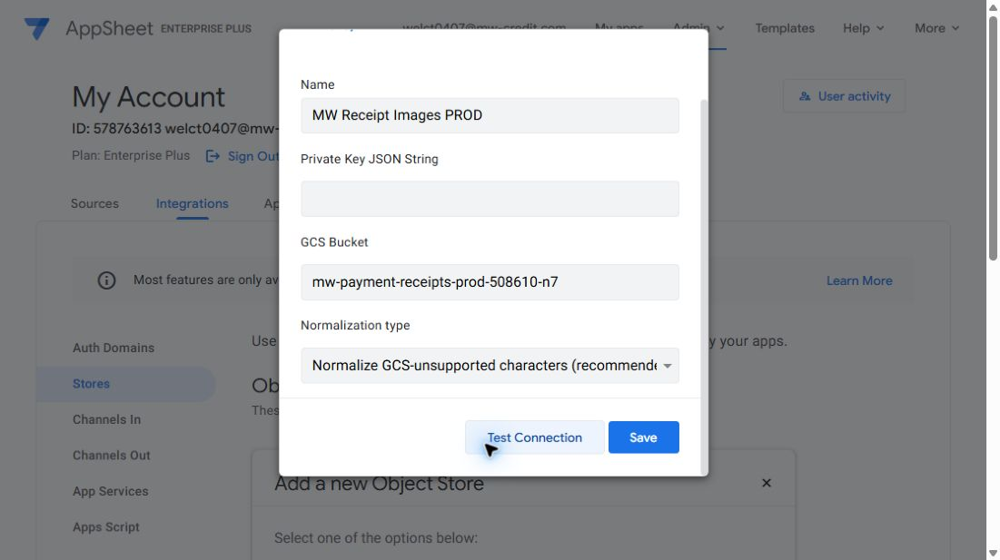

# AppSheet–GCS connection checkpoint

27 September 2026 — **prepared; blocked by enforced service-account key policy; no connection saved**.

## Verified prerequisites

- AppSheet owner `welct0407@mw-credit.com`, account `578763613`, has Enterprise Plus. My Account → Integrations → Stores has no existing personal or team object stores.
- The live GCS connector form requires Name, Private Key JSON String and GCS Bucket. It offers Test Connection and Save. Recommended normalization is “Normalize GCS-unsupported characters (recommended)”.
- Existing bucket: `gs://mw-payment-receipts-prod-508610-n7`, project `clever-oasis-508610-n7` (`737787224638`), organization `594773370606`.
- The authenticated gcloud account is also `welct0407@mw-credit.com`. Read-only effective policy checks report `enforce: true` for **both** `iam.disableServiceAccountKeyCreation` and `iam.managed.disableServiceAccountKeyCreation`. Neither has a project-local policy, so the restrictions are inherited/default effective policy. No existing organization tag keys were returned.
- Existing service accounts are Compute Engine default, MW Integration Agent VM, Metabase Cloud SQL reporting proxy and MW Grafana Monitoring. None is a dedicated AppSheet receipt connector. Their credentials/access were not repurposed.

## Prepared configuration

One bucket is retained. Two connection credentials allow DEV to be restricted to synthetic objects without introducing another bucket or Debian agent.

| Setting | PROD | DEV |
| --- | --- | --- |
| Proposed AppSheet object-store name | `MW Receipt Images PROD` | `MW Receipt Images DEV` |
| Proposed dedicated service account ID | `appsheet-receipts-prod` | `appsheet-receipts-dev` |
| Bucket | `mw-payment-receipts-prod-508610-n7` | Same bucket |
| Intended access | Read receipt images; no writes/deletes | Read only `test/receipt-storage/` synthetic objects; no writes/deletes or production object listing |
| App targets from environment inventory | OLTP `93844270-6aa5-420b-a960-bcdf08abd357`; OLAP `e74dd368-654f-44d7-bccf-83cf361d1cdb` | OLTP `500b27b6-884a-41e8-a9ec-df801b0110ad`; OLAP `9f3422be-bc87-4a5a-a42a-67528ee80393` |
| Table setting once connection passes | Payments → Store for image and file | Same table setting, DEV connection |
| Filename normalization | GCS-unsupported characters only | Same |

These names/grants are proposed, not created. The PROD form is filled except for its private key, and is not submitted. Exact least-privilege connector compatibility remains to be tested; the documentation's Storage Admin example is not authorization for project-wide storage administration. Conditional object access must be proven to deny a non-test path for DEV; prefix text alone is insufficient. If native Test Connection needs broader list/write rights, record the actual failure before changing the design.

## Required owner decision

The native connector needs an exported JSON key. Creating one is prohibited by the two effective organization policies. The request to configure connectivity does not explicitly authorize relaxing that existing security protection.

Proposed exception: exempt **only the two dedicated AppSheet receipt service accounts** from both key-creation restrictions using supported tag-based conditions, retain enforcement for every other service account, create the required keys, then remove the temporary exceptions after key creation. Removing a key-creation exception does not revoke an already-created key. The long-lived keys would remain in AppSheet until revoked/rotated. This is the material security tradeoff requiring explicit approval. Do not disable either policy project-wide or organization-wide as an unreviewed workaround.

Before applying an approved exception, capture the effective/source policies and exact existing local-policy state, verify tag-condition support for both constraints and the owner's administrative permissions, and prepare guarded policy changes that preserve other rules. If the scoped exception cannot be implemented, stop that step rather than silently broadening it.

Keys, if approved, must remain outside Git under `C:\Users\MWCredit\Documents\ChatGPT\AppSheet-Loan-Project\receipt-storage\`; never print their contents. Record actual recovery coverage rather than assuming that directory is backed up.

## Remaining execution

1. Obtain the scoped policy-exception decision above; create dedicated identities, narrowly scoped bucket grants and credentials only when that path is approved and feasible.
2. Test and save both account object stores. Verify actual object read and DEV denial with synthetic fixtures; connector Test Connection alone is not end-to-end evidence.
3. Inspect live Payments table image/file dependencies and record each affected app's current restorable version before binding. Inventory versions are historical and have not been recertified in this checkpoint. Apply app-definition changes through the repository's DEV/RC/App Upgrade workflow under the current Open release (R046 at inspection); do not silently hand-edit PROD definitions. Resolve any conflicting existing file storage before changing the table-wide setting.
4. Verify saved bindings, affected editor diagnostics and image retrieval in the current GUI; update owning dictionary objects and release records. Receipt columns/capture/projector are a later implementation scope unless separately included.

## Changes, rollback and evidence

This checkpoint made no GCP IAM/policy/key/resource mutation, saved no AppSheet store or app definition, and wrote no business data. Closing the unsubmitted form discards the draft. Existing bucket settings are unchanged. Local starting commit: `689aebec37af052e35c6a1ba69cc88de1bf75481`; unrelated working-tree files preserved.

Official references: [AppSheet GCS configuration](https://support.google.com/appsheet/answer/10106382?hl=en), [service-account policy exceptions](https://docs.cloud.google.com/iam/docs/troubleshoot-org-policies), [managed and legacy key restrictions](https://docs.cloud.google.com/organization-policy/restrict-service-accounts).
