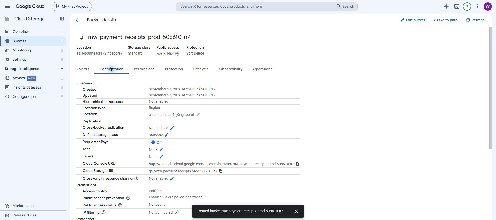
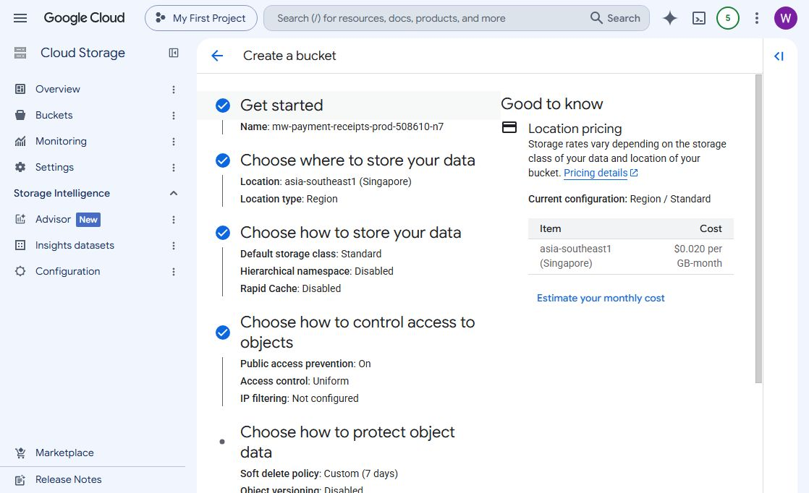

# GCS configuration for owner review

27 September 2026 — **created after owner approval; saved configuration verified**.

## Creation result

Owner authorized creation with “go ahead to create the GCS.” Created `gs://mw-payment-receipts-prod-508610-n7` in `clever-oasis-508610-n7`; console creation timestamp: **27 September 2026, 02:44:17 Asia/Bangkok**. The Objects page confirmed an empty bucket and successful creation. The Configuration page confirmed Singapore/Region, Standard, uniform access, public access prevention inherited from organization policy, not public, seven-day soft delete, versioning off, no retention policy, object retention disabled, Google-managed encryption and no lifecycle rules. Hierarchical namespace, cross-bucket replication, CORS and Requester Pays are off; Rapid Cache and IP filtering are not configured. Customer-supplied encryption keys are restricted; Google-managed and Cloud KMS keys are allowed.

No application-specific IAM grants, service accounts/keys, uploads, SQL/app changes or agent activation were performed. Agent and AppSheet access/setup remain future work. Existing inherited IAM was not changed or comprehensively audited. The sections below preserve the reviewed configuration and pre-creation observations, not a claim that creation is still pending.

[Open the created bucket](https://console.cloud.google.com/storage/browser/mw-payment-receipts-prod-508610-n7?project=clever-oasis-508610-n7).

The proposal is now one private bucket for the existing Debian agent. There is no DEV bucket and no separate AppSheet display bucket. Store an original once and reference that same object from Payment Detail. Only create a same-bucket format conversion if actual AppSheet rendering requires it.

## Prepared configuration

| Setting | Value |
| --- | --- |
| Project | `clever-oasis-508610-n7` — My First Project |
| Bucket name | `mw-payment-receipts-prod-508610-n7` |
| Location type / region | Region / `asia-southeast1` (Singapore), matching the documented Debian VM |
| Default storage class | Standard; Autoclass off |
| Public access prevention | On; required by the project's organization policy |
| Access control | Uniform bucket-level IAM; required by organization policy |
| IP filtering | Not configured; do not guess AppSheet egress addresses |
| Soft delete | Explicit **7 days / 604800 seconds** |
| Object versioning | Off |
| Bucket retention policy / retention lock | Off |
| Object retention | Off |
| Encryption | Google-managed by default; no customer-managed key configured |
| Allowed encryption rules | Console default: Google-managed and Cloud KMS |
| Hierarchical namespace / Rapid Cache | Off / off |
| Cross-bucket replication | Off |
| Lifecycle deletion or class transitions | None proposed |
| Optional labels | None entered |

Seven-day soft delete means recovery remains possible for seven days **after deletion**. It does not delete live receipts after seven days. Live objects remain until deliberately deleted; no automatic purge or immutable retention lock is proposed.

The console displayed **USD 0.020 per GB-month** for Standard Singapore storage. Operations, data transfer, taxes and retained soft-deleted bytes may add costs; this is not a total monthly quote. There is no routine second image copy in this design.

## Scope of the next creation action

Creation would make this one empty bucket with the settings above. It would not grant new agent/AppSheet permissions, create service-account keys, upload receipts, change SQL/apps or enable capture. Effective inherited project IAM must be inspected when setting application access; private does not remove existing project administrators' access.

Later, the trusted AppSheet connection can read receipt objects in this bucket. Unlinked archive records are not loaded into the app, but the backend credential is not isolated from unlinked objects by a separate bucket. Verify AppSheet's authenticated row/file controls and guessed-path handling before image activation.

Synthetic checks can use `test/receipt-storage/<run-id>/` with isolated temporary state and stubbed financial/notification clients. A prefix is not a security boundary: DEV AppSheet test access must be limited to synthetic objects. Resolve any connector limitation when testing it; do not provision a permanent DEV agent or bucket preemptively.

## Observations and handoff

- Verified selected console account `welct0407@mw-credit.com` in the mapped Chrome work profile.
- Bucket listing showed no existing buckets at initial inspection.
- Final form name, Singapore location, Standard class, public-access prevention, uniform access, seven-day soft delete and default encryption were read back.
- **Create was never clicked.** No GCS resources, IAM grants, credentials or data were created.
- The superseded display-bucket draft was closed. Only the single-bucket form is retained for review.
- Name syntax passed the form step; global availability is not reserved or guaranteed until creation succeeds.
- Browser drafts are temporary. If reloaded, restore the settings from this document and verify before submission.

[Updated implementation handover](HANDOVER.md).
