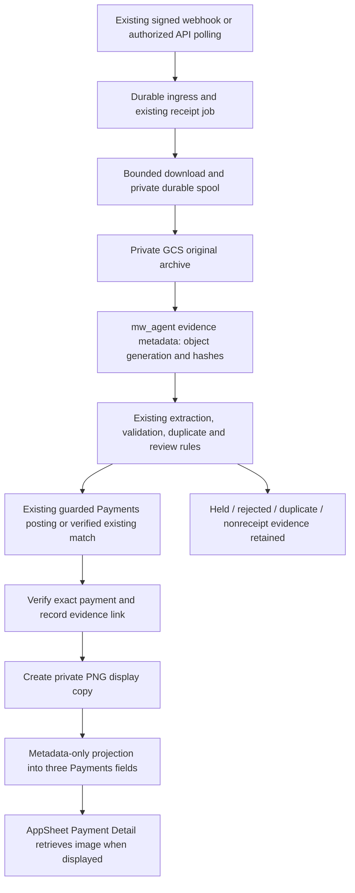

# Receipt picture capture and storage — implementation handover

Date: 27 September 2026. Status: **design complete; implementation and deployment not performed**.

## 1. Decision and scope

Use private Google Cloud Storage (GCS) for receipt pictures, the existing agent PostgreSQL database for archive metadata, and three small physical fields on `public."Payments"` for AppSheet display. Keep the archive out of both AppSheet apps. Show the picture in `Payments_Detail`, with offline content caching disabled and no receipt thumbnails in lists.

This follows the owner's [shared Receipt Storage Design conversation](https://chatgpt.com/share/6ab8189b-05dc-83ec-a8d1-0ce238437fa3), read through the public shared page on 27 September. Its main decisions are GCS over Drive, original evidence outside the financial database, lightweight Payment references, and on-demand viewing. This handover adds the concrete Debian integration, failure recovery and access boundaries.

Two refinements are intentional:

- Put the archive catalogue in the already-established `mw_agent` database, rather than adding an agent-only archive table to `loan_manager_prod`.
- Separate original evidence from AppSheet display copies using an archive bucket and a display bucket per environment. This prevents the AppSheet connection from reading rejected, unrelated or unlinked intake pictures. Display copies are reproducible derivatives, not a second authoritative archive.

The requested work is design/documentation only. All names marked **proposed** below are contracts for implementation, not existing objects or grants. No release number or migration number is reserved. No live VM, bucket, database, app, payment or notification was changed. Schema additions, access grants, application changes and activation need the owner's implementation authorization; production promotion remains separately scoped under repository policy.

### Capture coverage

Capture every new image attachment admitted to the existing receipt engine after its current ingress/processing cutoffs, including subsequently posted, duplicate, rejected, held and extraction-failed candidates. Preserve each attachment separately. A failed download gets a durable missing-evidence record, never a claim that a picture was saved. Definitively unrelated images are marked nonreceipt and never displayed from Payments; initially retain captured candidates without an automatic purge policy.

This does not expand Instagram intake, borrower enrollment, group membership rules, messaging or posting authority. No whole-account history crawl, automatic historical backfill, new PDF processing, bank-settlement verification or Drive mirror is included. Operator-selected preparation remains read-only financially; once archive capture is authorized, it may save its selected evidence without creating a payment or notice. Existing receipt processing cutoffs are preserved; a separate archive cutoff controls new capture.

## 2. Evidence and current implementation

This is repository inspection, not a fresh audit of the deployed VM. Recheck deployed hashes and actual targets before implementation.

| Evidence | Observed fact and design consequence |
| --- | --- |
| AppSheet repository starting commit `23c007105714c6c56b8484968019abd17f7e9a03` | [Environment inventory](../../Documents/Environment_Inventory.md) records the GCP Debian integration runtime and separate `mw_agent` database. |
| Integration-agent checkout `8efd92561f8b0550fb51e7f2993f73cbe7ee6504` | Canonical runtime is `C:\GitHub\MW-Integration-Agent`, Debian 13/Python 3.13 on `vm-mw-credit-agent`, project `clever-oasis-508610-n7`, region `asia-southeast1`. It is not the old Windows collection runtime. |
| Agent `SERVICE_CATALOGUE.md`, `service-catalogue.json`, `docs/PARTNER_REVIEW.md` | Revision 22 governs current receipt review. Ordinary eligible receipts may auto-post; overpayment needs correlated approval; closure stays manual; UNKNOWN posting is readback-only. Do not import old collection policy over this catalogue. |
| Agent `docs/POSTGRESQL_OPERATIONS.md`, `src/mw_integration_agent/state.py` | Six journals use `mw_agent` through the existing loopback proxy. `.db` filenames in source are compatibility identifiers, not evidence that production state is SQLite. |
| Agent `receipt_image.py:download/canonical_image` | Fetch accepts bounded approved Meta HTTPS hosts, limits download to 12,000,000 bytes and decoded image to 20,000,000 pixels; JPEG/PNG/WEBP are converted to normalized PNG. Its current hash covers normalized RGB pixels and dimensions, not original downloaded bytes. |
| Agent `receipt_journal.py:ingest/mark/accept` | Job ID is SHA-256 of `message_id:attachment_index`. `mark` and `accept` clear `image` and `url`; current terminal processing therefore does not provide a permanent image archive. |
| Agent `receipt_run.py:process`, `receipt_prepare.py`, `receipt_reconsider.py` | Normal processing, owner-selected preparation and explicit reconsideration share extraction/rules but have different entry paths. All need the same evidence adapter; normal duplicate exits must occur after archive capture. |
| Agent `review_execution.py`, `partner_review.py`, `review_cycle.py` | Posting commits intent before one Payments Add; deterministic payment key and readback protect uncertainty. Review records already contain job/payment linkage. Reuse these identifiers. |
| [Payments database definition](../../Documents/Data%20Dictionary/systems/postgresql/relations/payments.yaml), both apps' Payments definitions | Payment is the correct financial receipt parent. Proposed archive/display fields are absent from the inspected definition. Keep existing immutable Row IDs, financial dates and allocation grain. |
| [OLTP Payment detail](../../Documents/Data%20Dictionary/systems/appsheet/oltp/views/payments-detail-ff6a02d3.yaml), [OLAP Payment detail](../../Documents/Data%20Dictionary/systems/appsheet/olap/views/payments-detail-ff6a02d3.yaml) | Both apps are consumers. Auto-selected image settings require review after regeneration to prevent new list thumbnails. |

Agent source links are pinned under [the inspected commit](https://github.com/welct0407/MW-Integration-Agent/tree/8efd92561f8b0550fb51e7f2993f73cbe7ee6504). `docs/RECEIPTS.md` retains earlier summary-only/SQLite statements; later catalogue, review documentation and current source establish the design baseline. Resolve remaining drift during implementation rather than repeating those older claims.

## 3. End-to-end flow



Do not download or call a model inside the webhook request. Acknowledge only after durable ingress as today. Service-owned capture drains the admitted attachment queue before slower extraction work, with bounded work per cycle so receipt review/reconciliation/notices still run. Prefer this inside the existing receipt service/timer; no second payment scheduler is needed.

For new archive-enabled candidates, successfully preserve the original before extraction/terminal cleanup and before any new financial dispatch. A capture outage pauses only the affected new candidate before posting. It never blocks readback of already-dispatched payments, existing review replies, independent notices or unrelated jobs. Once the original is archived, display publication failure must not undo or retry a financial transaction.

## 4. Storage and identity contract

### GCS layout — proposed

Use regional Standard storage in `asia-southeast1`, with separate DEV and PROD buckets. Resolve globally available names at implementation; examples are placeholders:

```text
<project>-receipt-archive-<env>
  originals/v1/<capture-UTC-year>/<month>/<receipt_id>/<raw_sha256>.<jpg|png|webp>

<project>-receipt-display-<env>
  payments/v1/<opaque-publication-id>/image.png
```

Persist the chosen key once; retries do not derive a different date or path. Keys contain no borrower name, account number, amount, message text or expiring Meta URL. `opaque-publication-id` is a stored random identifier generated once for a link revision. AppSheet receives the exact relative display key, never a public URL, signed URL, `gs://` URI or archive-bucket path.

**Original** means the exact bytes retrieved from the approved Meta attachment endpoint. Instagram may already have transformed the sender's file; do not claim camera-original or bank-original provenance. Compute a separate raw SHA-256 before decoding. Keep the existing normalized pixel hash unchanged for financial duplicate checking. Hash equality is evidence identity, not proof of a settled transfer.

Store immutable original bytes with validated MIME type, byte size, GCS generation, CRC32C and raw SHA-256. Generate the PNG view from the archived original using the existing orientation/RGB normalization; it must remain fully legible and uncropped. Record derivative version, hash and generation. Bound derivative output/memory as well as input size. Do not silently downsample financial text; an oversized derivative enters display review while the original remains safe.

Use create-only uploads with `if_generation_match=0`. After success or uncertain upload, read the exact object and verify generation, size and checksums; on an existing object, compare the expected content hash using verified bytes if necessary. A mismatch is an integrity conflict, never an overwrite. This gives safe storage retries independently of financial idempotency. [GCS preconditions](https://docs.cloud.google.com/storage/docs/request-preconditions).

### Access

- Both bucket classes: uniform bucket-level access, public access prevention, Google-managed encryption, no public principals. Originals are readable only by the authorized worker and evidence administrators. [Public access prevention](https://docs.cloud.google.com/storage/docs/public-access-prevention).
- Worker: use Application Default Credentials from the verified attached GCE service account; no downloaded worker key. Grant bucket-scoped create/get and only the additional metadata/list access actually required by tested reconciliation. No delete, overwrite, bucket administration or unrelated storage access. Check that a local ADC file/environment variable does not override the intended identity. [ADC behavior](https://docs.cloud.google.com/docs/authentication/application-default-credentials).
- AppSheet: a separate dedicated connection identity, restricted to its environment's display bucket; no original-archive access. Google documents a JSON-key connection and a broad Storage Admin example. Treat minimum get/list/bucket-metadata permissions as a DEV compatibility test, not proven support. Record the exact successful grant set; do not silently widen it to project-level administration. If the connector requires writes, constrain them to the display bucket and document the exception. [GCS connector setup](https://support.google.com/appsheet/answer/10106382?hl=en).
- Store any AppSheet connection-key export outside Git under the owner's designated private credential root. On Debian, secrets remain under `/etc/mw-integration-agent`; spool under `/var/lib/mw-integration-agent`, mode 0700 with files 0600. Follow existing verified recovery/credential handling; do not delete the only recovery copy as a side effect of setup.
- Preserve AppSheet sign-in, Payment row security and file/image access protections. Hidden columns and opaque names are not access controls. Verify that one authorized app user cannot obtain another unauthorized Payment's picture by changing a path. Keep generated capability URLs and browser caches private; private buckets alone do not prevent an authorized viewer from saving a displayed image.

Separate buckets protect unlinked originals even if the connector needs broad display-bucket access. They do not claim per-row authorization inside GCS: that boundary must be enforced and tested by AppSheet. If native access cannot meet that test, hold image activation and design an authenticated viewer; do not make files public to resolve a broken image.

## 5. Proposed data model

Use new immutable central migrations in `MW-Integration-Agent/database/migrations/`, plus an independent business Flyway migration in this repository. Allocate actual versions only after checking both current histories. Do not edit V1–V3 or presume the next unused number.

### A. `mw_agent.runtime.receipt_assets` — one admitted source attachment

This is the concrete equivalent of the shared conversation's `ig_receipt_archive`. It is not an AppSheet table.

| Proposed field(s) | Type / constraint / meaning |
| --- | --- |
| `receipt_id` | text primary key; SHA-256 of a canonical JSON array `["receipt-v1", environment, ig_account_id, job_id]`; retain existing `job_id` unchanged |
| `environment`, `ig_account_id`, `job_id` | text, required; unique together; DEV and PROD are never merged |
| `source_message_id`, `attachment_index`, `source_attachment_id` | required message/index, optional provider ID; never substitute an expiring URL for identity |
| `source_kind`, `source_sender_id`, `source_conversation_id` | webhook, poll or operator-selected; sender and verified forwarded-group provenance retained privately |
| `source_sent_at`, `captured_at`, `downloaded_at` | `timestamptz`; capture time comes from durable ingress, not retry time; distinguish sent, captured and bank transfer time |
| `original_bucket`, `original_key`, `original_generation` | fixed object locator after verified capture; generation stored without numeric precision loss |
| `raw_sha256`, `pixel_sha256`, `crc32c`, `mime_type`, `byte_size` | byte integrity and existing visual duplicate identity kept separate |
| `archive_state`, `attempts`, `next_attempt_at`, `last_error_code` | durable bounded acquisition/upload state; safe error codes only |
| `classification`, `classified_at`, `extractor_revision` | receipt/nonreceipt/unknown; existing extraction/result data stays in the receipt job unless an immutable audit snapshot is needed |

Validate job/source association against current ingress. Attachment order is the current identity mechanism: retain the frozen ingestion index, store provider ID when available, and reject conflicting payloads rather than recomputing keys from reordered history. Never change existing duplicate keys to accommodate the new archive.

Original source fields and a verified locator/hash become immutable after capture; enforce through migration-defined guards and explicit grants, not comments alone. Mutable status is only a projection. Record transitions/corrections in existing append-only `audit.events` under an archive operation. Do not copy image bytes, signed source URLs or entire OCR/account data into audit payloads.

Archive states are SOURCE_PENDING → LOCAL_READY → UPLOADING → ARCHIVED. Upload uncertainty remains UPLOADING with reconciliation due; a restart never interprets it as failure to create the object. Unrecoverable source loss becomes SOURCE_UNAVAILABLE; content disagreement becomes INTEGRITY_CONFLICT. Retryable errors retain the last durable stage. A deliberate operator recovery is audited and does not reset financial job state. For operator-selected history, record a new acquisition/capture timestamp and preserve the original source timestamp separately; do not impersonate an earlier webhook capture.

### B. `mw_agent.runtime.receipt_payment_links` — one evidence association revision

| Proposed field(s) | Type / constraint / meaning |
| --- | --- |
| `link_id`, `receipt_id` | primary key and real FK to receipt_assets; stable operation key for reconciliation |
| `business_environment`, `payment_id` | exact existing Payments Row ID and database environment; no cross-database PostgreSQL FK is possible |
| `link_reason`, `verified_at`, `verification_digest`, `actor` | created-by-job / verified-existing-reference / owner-correction; evidence of the exact match and authority |
| `is_primary`, `superseded_at` | one active primary image per Payment; preserve superseded history |
| `publication_id`, `display_key`, `display_generation`, `display_sha256` | immutable display version; nullable until publication succeeds |
| `projection_state`, `attempts`, `next_attempt_at`, `last_error_code` | NONE / PENDING / APPLIED / UNKNOWN / CONFLICT; separate from payment state |

Use a partial unique index on `(business_environment, payment_id)` for active primary links; unique active receipt/payment pairing; foreign keys without cascade deletion. The v1 financial model permits each asset to have at most one active payment association. Several archived attachments may be associated with one Payment, but only one primary is projected into AppSheet. Exact-image duplicates still retain separate source records. Additional images remain available for restricted evidence inspection; showing all of them in AppSheet is a later child-table/UI extension with an explicit metadata-sync cost.

Cross-database integrity is checked by the projector against the exact Payment, borrower, amount, receiving account, normalized reference and transfer date/time, together with current posting state. Store a verification digest of canonical facts. No guessed linkage from amount/date alone. Run bounded reconciliation for missing/mismatched business rows; do not automatically reassign evidence.

### C. `loan_manager_dev/prod.public."Payments"` — three nullable fields

| Proposed column | Database / AppSheet type | Purpose |
| --- | --- | --- |
| `IG Receipt ID` | text / Text, hidden from routine UI | Primary archive identifier; **not AppSheet Ref**, since the archive is not loaded |
| `Receipt Image` | text / Image, read-only | Relative key in the configured display bucket |
| `Receipt Received At` | timestamp without time zone / DateTime, read-only | First ingress capture converted explicitly to Bangkok wall time for the existing app/API convention |

The archive retains the canonical UTC timestamp. `Receipt Received At` is not transfer time and never changes `Payment Date`, `Created At`, `Processed At`, financial ordering or amounts. Use a deterministic UTC-to-Asia/Bangkok conversion and test midnight boundaries. Match the actual connector convention at implementation; if the inspected live app requires another SQL timestamp mapping, revise and document it before migration.

All three fields are nullable and populated together; existing/manual/cash Payments remain valid without evidence. No virtual-column archive join, binary column, historical financial backfill, new per-row aggregate or archive Ref is added. Guard writes so a partial triplet or an arbitrary URL/path cannot be accepted.

Enforce service ownership in the database as well: ordinary Add may leave the triplet null; ordinary edits may preserve it unchanged; only the restricted projector or an explicitly authorized recovery procedure may change it. This prevents a stale AppSheet row or generic API/DML tool from clearing or substituting evidence despite read-only UI configuration.

### Metadata-only projection

Recommend a narrowly scoped business function, proposed `public.attach_payment_receipt_evidence(...)`, invoked by a dedicated projector credential with EXECUTE only. This is a justified `atomic:` SQL operation: exact expected-current-values, locked row validation, three-field update and audit must succeed together. It is not a general model SQL tool and grants no new financial editing authority.

The function must pin its search path, validate caller/environment, lock the exact Payment, compare expected old triplet and financial verification facts, validate the receipt ID/display-key format, and set only the three new fields. Identical repeats return already-applied; a different existing primary returns conflict. Normal linking requires verified Posted status. Corrections require explicit owner authority and an append-only supersession event; no automatic overwrite.

Inspect affected Payments UPDATE triggers first. A metadata-only update must not recompute postings, send a payment notification or bypass financial immutability. Exercise this in DEV. Extend the existing business transaction audit/outbox for the specific projector role/function so central-DB acknowledgement loss can be reconciled; do not grant that role reviewer DML. Existing broad model discovery must not make evidence fields writable: add them to conversation API/DML protected-field rules and refresh private app metadata after app changes. No permanent worker cross-database superuser credential is needed.

The existing Payments Add remains financially unchanged. Only after its current exact readback succeeds does the projector publish a receipt link. It also supports a uniquely verified already-recorded Payment, without Add or a new success notification. Do not automatically attach ambiguous, unposted, conflicting or historical matches. When a manual Payment already has a primary image, retain the new evidence association without replacing that primary.

## 6. Failure handling and state transitions

Acquire evidence before calling `canonical_image`; the current function discards raw bytes. Refactor the downloader to return an explicit bundle containing raw bytes/path, MIME, raw hash, normalized PNG and pixel hash. Never label today's normalized PNG as the original.

1. Reserve the asset row using the stable job/source key. Download with existing TLS/host/redirect/size checks; validate every redirect. Do not accept URLs supplied by OCR or a reviewer instruction.
2. Write the exact raw download to a temporary spool file, flush/fsync, atomically rename, and fsync its directory. Commit its hash and local-ready state. Recover file/DB gaps by deterministic key and verified hash; do not trust an incomplete temporary file.
3. Upload/create-only and verify GCS; commit ARCHIVED plus immutable locator/hash. The source URL may then expire without losing evidence. Local spool can be removed only after durable archive confirmation.
4. Run current normalization/extraction/rules from the verified evidence. Preserve financial duplicate policy and existing extraction attempt count. Archive upload retries have a separate counter and must not exhaust model attempts.
5. Terminal job cleanup may clear its old transient `image`/`url`, but never asset identity or verified evidence. A cleanup guard refuses removal of the only captured copy. New processing should use private files, not grow PostgreSQL bytea storage.
6. After verified posting/existing match, reserve link and display publication, then project metadata. Any failed stage resumes independently; it never enters the Payments Add branch again.

| Failure / interruption | Required recovery |
| --- | --- |
| Meta image unavailable, invalid or too large | Preserve source metadata and a precise unavailable/rejected status; use existing hold/operations handling. No fabricated image or payment. Do not retain unlimited invalid payload bytes. |
| GCS/DB unavailable after local capture | Retain private spool, exponential backoff with jitter, show archive backlog. Continue independent jobs. No new financial dispatch for this archive-required candidate. |
| Upload accepted but acknowledgement lost | Read deterministic object and verify; conditionally retry create only when appropriate. Never overwrite an existing object or infer a second receipt. |
| Original archived, extraction fails or says nonreceipt | Retain original and classification/failure status; no Payment linkage for nonreceipt. |
| Duplicate detected before extraction or posting | Original is already captured; retain source occurrence and duplicate relation. Link only on an independently verified exact existing Payment. |
| Payment Add unknown | Existing deterministic payment-key readback only. Archive survives; no Add retry, no claim of successful payment from an image. |
| Payment posted, display generation/upload fails | Payment stays posted; retry only the derivative/publication. Original remains accessible to authorized operations. |
| Business metadata committed, central acknowledgement lost | Mark projection UNKNOWN; compare exact triplet plus transaction audit before acknowledging. No financial or notification replay. |
| Old/new primary differs or row facts changed | CONFLICT for explicit resolution; do not replace a partner's evidence automatically. |
| Spool pressure | Proposed initial limits: warn at 70% of configured quota, stop new capture before quota exhaustion; keep durable ingress and retry existing uploads. Never evict unarchived files. Size quota from measured peak intake and outage duration. |

Storage backoff proposal: 30 seconds rising to 15 minutes, with a bounded per-cycle time/byte budget and operations attention after 15 minutes pending. A retry budget must stop hot loops without discarding work. Preserve the one-image-per-cycle extraction policy unless performance evidence justifies changing it. Explicit reconsideration should first use the archived original; archive availability never authorizes reconsidering or replaying a payment.

## 7. AppSheet experience and sync contract

Both OLTP and OLAP already load Payments. Regenerate only the affected table in both DEV apps, review generated changes, configure the environment's GCS display store, and add the image and received timestamp to `Payments_Detail`. Keep Payment amount, transfer date/time, receiving account and status readable before the evidence. Picture is view-only, full-aspect and tappable for inspection; no capture/upload, quick edit, camera action or automatic cover-image selection. A missing image means evidence is not linked/available, not that the Payment is invalid.

Use explicit column/view configuration so list, deck, inline and related Payments views do not automatically pick the new Image column. Forms retain existing payment entry behavior and hide the service-owned fields. API/DML protections enforce immutability separately from UI settings.

AppSheet supports Image/File storage using stored filenames and GCS connections, with Enterprise Plus required. The shared conversation says the plan was upgraded; verify the actual app-owner entitlement during implementation. Prove externally uploaded relative-key resolution using a synthetic image in DEV before relying on a guessed folder convention. [Object-store behavior](https://support.google.com/appsheet/answer/10106769?hl=en).

Leave **Store content for offline use = Off**. The Payment rows and three values participate in sync; the archive rows do not. Images normally load when referenced for display, with AppSheet/client caching possible. This is not a promise of zero image requests during every sync or zero latency: auto-images, an already-open detail, prefetch/cache behavior and app version can affect traffic. [Offline/sync behavior](https://support.google.com/appsheet/answer/10107724?hl=en).

Illustrative sizing only: 10,000 Payments × 300 bytes of extra values is about 3 MB before protocol overhead; 10,000 pictures × 2 MB is about 20 GB of stored picture data. Actual sync bytes depend on selected rows and sync mode. Measure baseline and changed cold-start sync with identical data/device/network, then separate first-picture opening from repeat cached opening. Do not claim a measured speed improvement or fixed overhead before testing.

Avoid changing Quick Sync, Delta Sync or security filters to compensate for this feature. The purpose is bounded additional Payment metadata and no archive-wide image fetch. Previously viewed images may remain in device caches; offline viewing is not guaranteed by this design.

## 8. Retention, recovery and operations

Initially retain archived originals and evidence links indefinitely within this prototype, with no automatic lifecycle deletion, object overwrite or locked retention policy. This is a conservative implementation default, not a legal retention requirement. Keep soft delete enabled with an explicitly recorded duration; proposed minimum is seven days. Decide longer retention/recovery targets from operational needs before activating a purge process. [Soft-delete behavior](https://docs.cloud.google.com/storage/docs/soft-delete).

Worker immutability is enforced by permissions, create-only writes and database guards; it is not protection against a trusted cloud administrator. No irreversible bucket retention lock is proposed. Display copies are rebuildable from verified originals and versioned transform code. Do not copy receipts to Git, ordinary logs, report snapshots or notification attachments.

Recovery covers three assets separately: GCS originals, `mw_agent` metadata/audit, and business Payment projections. Cloud SQL PITR and VM snapshots do not back up GCS objects. Test restoring a synthetic deleted original, metadata from a private database restore and its display link; verify exact bytes. Restoring a GCS object can produce a new generation: record a recovery event and the replacement locator, preserving the original recorded generation. Do not restore old operational journals over new payments or sends.

The resolver may use an explicitly authorized recovery locator recorded in append-only audit, with a mutable current-locator projection for efficient reads. The original asset locator/hash remains unchanged; recovery must prove identical bytes before making that override active. A replacement picture is new evidence and needs a new association revision, not a recovery override.

Use the existing collector for aggregate metrics: pending capture count/oldest age, missing originals, checksum conflicts, spool usage, failed display publications and unlinked posted Payments. Keep UNKNOWN distinct from zero. Labels/logs contain no borrower, bank reference, image URL or image content. Extend `receipt_health.py` without breaking existing monitoring fields; dashboard changes also require the resource-monitoring visual guide in this repository. No new alert delivery channel is introduced by this design.

Capacity planning uses original bytes plus display bytes, retained failed candidates, operations and download traffic; no current dollar estimate is claimed. Record actual average/maximum sizes after a controlled sample. Keep region and lifecycle decisions explicit; do not move rarely viewed evidence to a class with retrieval/minimum-duration costs without measurement.

## 9. Implementation map and sequence

| Owner / affected files | Work |
| --- | --- |
| Integration agent: `receipt_image.py` | Separate raw acquisition from normalization; bounded bundle and integrity hashes. |
| Integration agent: proposed `receipt_archive.py` | Shared capture, spool, conditional upload, verification and recovery service; pinned GCS dependency in root environment. |
| Integration agent: `receipt_journal.py`, `receipt_run.py`, state adapter/migrations | Durable archive identity/work; capture before duplicate/terminal exits; preserve cleanup invariant; short DB transactions. |
| Integration agent: `receipt_prepare.py`, `receipt_reconsider.py` | Same evidence service; archive-first read on authorized reconsideration; no new payment authority. |
| Integration agent: `review_cycle.py`, `review_execution.py`, `payment_match.py` | Surface verified exact Payment identity to the evidence linker, including exact existing-reference matches; preserve Add/readback semantics. |
| Integration agent: proposed `receipt_projection.py`, business grants | Display publication and restricted metadata function call/readback; independent durable retries. |
| Integration agent: config/catalogue, conversation field protections, audit, `receipt_health.py`, tests/docs | Default-off archive/projection switches, immutable archive cutoff, fail-closed configuration, protected evidence fields, sanitized telemetry and updated current runtime documentation. |
| AppSheet repository: business migration, selective dictionary objects, both app definitions | Three fields, restricted audited projector, dependency review, image display and both-app checks. |

1. Recheck actual VM/package/configuration, database instance/database tuples, app IDs, current migration histories, object-store entitlement and affected Payments triggers. Read the current Open release before product development; keep it Open until authorized promotion begins. Record exact dependencies across the two repositories.
2. Obtain scoped approval for the proposed schema/access/implementation. Record rollback for affected code, consistent central state, business databases and both restorable app versions before mutation. No Looker backup is needed unless a report is actually changed.
3. Prove the GCS connection in DEV with synthetic evidence: externally uploaded relative image path, minimum identity grants, private access and current phone/browser behavior. Choose and record actual bucket/store names. This resolves the principal integration uncertainty early.
4. Implement additive central/business migrations, capture service and tests. Use isolated synthetic agent state with a nonproduction database/configuration; the current state adapter hardcodes `mw_agent`, so do not repoint the live worker casually. A test namespace in live production state is not an isolation substitute. Keep existing backend generation and production cutoffs unchanged.
5. Test crash/failure paths and metadata projection, including absence of posting-trigger/notification effects. Regenerate/configure both DEV apps and reconcile affected workflows. Verify directly affected Metabase question 317/V46 provider remains valid; no report image hosting is in v1. Its previous 'all payment details' wording must be clarified if new evidence fields are deliberately omitted.
6. Complete selective dictionary/design/runtime documentation and readiness evidence. Both app editors must have zero warnings/errors. AppSheet field protections, API metadata and downstream projections must agree before activation.
7. On authorized promotion, use the release's single master checklist, exact migration pins, independent PROD-mapped RC copies and App Upgrade into existing PROD apps. Record display-store substitution explicitly; DEV uses only DEV evidence. RC copies never copy receipt data and retain scheduled guards. Follow normal RC deletion/closure rules after successful validation.
8. Deploy reviewed Debian code/config/catalogue with existing recovery procedure. Activate archive and projection for a new explicit cutoff only after schemas, stores and app versions are compatible. Pre-cutoff pending jobs keep their existing financial policy; any archive catch-up is a separately selected archive-only operation. No historical posting or notice replay.
9. Observe the first naturally arriving authorized receipt: original archived, existing workflow resolves, exact Payment links, both app details load, no extra Add/send. Do not create a production financial transaction just for a test. Until naturally observed, label that specific acceptance pending.

Historical recovery is optional later work. Some terminal jobs have already lost both image and URL, and Meta may no longer provide them. Report coverage as recoverable, normalized-only or unavailable; never regenerate a slip from OCR. An archive-only backfill may not enter receipt processing, reset cutoffs, reconsider a hold or send old notifications.

## 10. Acceptance matrix

All entries below are **future tests**, not claimed passing results of this design task.

| Case | Expected evidence |
| --- | --- |
| JPEG/PNG/WEBP receipt; rotation metadata | Original raw hash matches download; view is legible and oriented; pixel duplicate hash remains compatible. |
| Duplicate webhook plus polling occurrence; reordered history | One stable source asset for the same admitted attachment; no identity remap; distinct source occurrences retained when appropriate. |
| Same pixels/different encoding; same amount/different reference | Archive preserves both raw versions; existing pixel/reference policy remains authoritative; no new amount/date duplicate rule. |
| Reject, hold, nonreceipt and extraction exhaustion | Picture/metadata retained according to capture status; no unauthorized Payment linkage. |
| Download expiry, invalid redirect, oversized/decompression-bomb image | Bounded failure, safe code, durable missing evidence, no financial action. |
| Crash after local rename, upload, archive commit, display upload, business commit | Reconciliation identifies the completed stage; no missing sole copy, overwrite, duplicate Payment or notice. |
| GCS unavailable / disk quota reached / central DB unavailable | Durable backlog, visible health, bounded retries, independent workers continue; no unarchived new posting. |
| Automatic ordinary / approved overpayment / manual closure | Existing policies unchanged; link follows verified posting; closure stays manual. |
| Add timeout or UNKNOWN | Only deterministic readback; storage/projection recovery cannot call Add. |
| Exact manual-reference match / ambiguous match / existing primary | Link exact verified Posted row only; conflict stays unresolved; existing primary preserved. |
| Metadata projection retry/concurrent replacement | Identical repeat is a no-op; stale expected triplet conflicts; zero allocations/cash effects/notification changes. |
| Unauthorized API/DML edits, public object access, cross-row image access | Denied; no evidence-link tampering or original-bucket exposure through AppSheet. |
| Both app syncs/details/forms/lists and DEV/PROD separation | Three small values sync, archive table absent, no list images/bulk offline caching, correct store, normal forms/sync and zero editor issues. |
| Receipt captured around UTC/Bangkok midnight | Captured timestamp display is correct; transfer date/time and financial ledger unaffected. |
| Restore original + central metadata + business projection | Recoverable generation/hash trail; original verified; no journal rollback/replayed effect. |

## 11. Rollback and completion evidence

Disable the new archive/projection switches and drain or preserve current spool; do not disable unrelated services or erase journals. For archive-required work, rollback cannot silently resume posting without evidence: either keep those new jobs paused or obtain an explicit policy decision. Restore the recorded compatible package/config and AppSheet versions if required, leaving additive database columns/tables in place. Preserve all original objects, current financial history and audit records. Do not drop schema or revert a database to undo a display feature.

Before calling the implementation complete, record: code commits and migration hashes; actual environment/store identities and tested grants; backup/restore evidence; both app versions/diagnostics; synthetic failure-matrix results; measured sync/detail behavior; archive cutoff; naturally observed receipt result or explicit outstanding acceptance; documentation closure; verified Git publication and final release evidence. Keep any unresolved native-connector permissions/path/access test visible as a blocker to image activation.

This handover's remaining decisions are implementation approval, final bucket names, proven AppSheet permission/path behavior, spool capacity and any retention period beyond the initial no-purge default. The architecture and failure policy above are the recommended starting implementation, not a list of interchangeable approaches.
