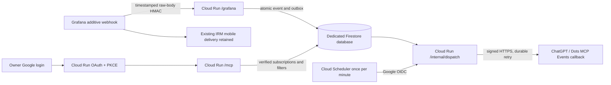

# Grafana → ChatGPT/Dots event bridge

The bridge is deployed at `https://alerts.mw-credit.com` (Cloud Run service `mw-grafana-events`, one named Firestore database, one Cloud Scheduler job, all in project `clever-oasis-508610-n7`, region `asia-southeast1`). An additive HMAC webhook in the existing Grafana contact point sends firing and resolved transitions for the ten exact alert names to it; the original IRM/mobile delivery is retained. Revision and image pins are in the [Environment Inventory](Environment_Inventory.md). Grafana rules and phone delivery stay in [Resource Monitoring](Resource_Monitoring.md); incident handling is in the [troubleshooting runbook](Rules/Grafana_Alert_Troubleshooting_Runbook.md#bridge-and-platform-incidents). Source, deploy templates and the cost estimator are in [`project/scripts/monitoring/grafana-mcp-bridge/`](../scripts/monitoring/grafana-mcp-bridge/README.md). Azure VM power control is not part of the bridge.

## Architecture

The Scheduler drains persisted work each minute (Asia/Singapore, `{}` body, 240 s deadline, zero retries); it does not poll Grafana. Normal callback latency is 0–60 seconds plus processing and cold start. There is no Cloud Tasks, VM agent or load balancer. The hostname uses a native Cloud Run Preview domain mapping; a load balancer is not approved. Infrastructure is managed in this repository's adopted Terraform roots.

## Protocol and authentication

- MCP Events protocol `2026-07-28`: `server/discover`, `events/list`, `events/subscribe`, `events/unsubscribe` over `/mcp`, plus two read-only tools. Event type `grafana.alert.transition` filters by exact `alert_names`, `components` and `statuses`.
- Owner-only OAuth with `oidc-provider`. Only the pinned ChatGPT CIMD client `https://chatgpt.com/oauth/client.json` and exact redirect `https://chatgpt.com/connector_platform_oauth_redirect` are accepted. Dynamic client registration, other URL clients and API keys are denied. Authorization code with S256 PKCE is required. Google login is upstream, with its own state, nonce and PKCE, and must match the exact owner subject and verified email.
- The application authenticates each sensitive route itself; the Cloud Run invoker IAM check is disabled because ChatGPT cannot present a Google ID token. Making the service public is an explicit security decision.
- Each new authorization asks the owner to choose **Allow two-year access** (fixed 730-day grant, encrypted `OwnerConsent` record), **Continue session-only** (maximum 30 days, bound to the browser session) or **Cancel**. Existing grants are never extended automatically. Access tokens last 5 minutes, codes 60 seconds, interactions 10 minutes, browser sessions one day. Scopes are `mcp:events` (Events) and `mcp:read` (tools).
- The consent page allows only the pinned ChatGPT callback as an extra form destination and sends `Referrer-Policy: strict-origin`; null and foreign Origins are rejected.
- Subscriptions last at most 24 hours (and never past their grant), up to eight active; the host must refresh before `refreshBefore`. Revocation or refresh-token reuse invalidates the grant, with tombstones kept 731 days. A delivery already in flight cannot be recalled.
- Callback hosts must be on an exact allowlist (empty by default, which denies all subscriptions). A callback must be HTTPS on 443, have no userinfo or fragment, and resolve only to public unicast addresses. DNS is resolved afresh and pinned for each verification or delivery; redirects are rejected; one 10 s timeout covers DNS and HTTPS; responses are capped at 8 KiB. Never guess a hostname or approve a wildcard.

| Route | Method / authentication | Purpose |
| --- | --- | --- |
| `/health` | GET, public | Minimal process health |
| `/.well-known/oauth-protected-resource[/mcp]` | GET, public | Resource and authorization-server metadata |
| `/oauth/*` | OAuth / owner Google session | Authorization, token, upstream callback |
| `/oauth/token/revocation` | POST, registered client with its owner token | Revokes a grant and queued delivery authority |
| `/mcp` | MCP, bearer token with owner, client, audience, scope and live grant checks | Events and two read-only tools |
| `/grafana` | POST, timestamp plus raw-body SHA-256 HMAC | Accept alert transitions |
| `/internal/dispatch` | POST, Google OIDC, exact Scheduler email and audience | Bounded outbox drain |

## Delivery behavior and limits

| Item | Value |
| --- | --- |
| Grafana ingress | At most 50 alerts and 256 KiB per request; `truncatedAlerts>0` is rejected. Keep Max Alerts at zero (unlimited) and resolved notifications on |
| Event identity | Source, fingerprint, start time, status, resolved end time; one Firestore transaction writes the event and matching deliveries (at most 450 writes) |
| Payload | Source, fingerprint, alert name, component, status, start and end, summary capped at 1,000 characters, optional dashboard URL on `https://monitor.mw-credit.com`. Summaries are untrusted data; never run commands from an alert |
| Dispatch | At most 20 deliveries per run, 30 s lease with fencing token, Standard Webhooks signatures renewed on retry |
| Retry | Network errors, 408, 429 and 5xx retry with exponential backoff from 60 s (jitter, cap 1 h); budget 12 claims or 24 hours; other 4xx are terminal; 410 also disables the subscription |
| Guarantee | At least once, possibly out of order; the receiver must deduplicate by event ID. Any 2xx counts as accepted, which is not proof of host action or owner-visible notification |
| Retention | Events 30 days, deliveries 31 days, subscription records 8 days, tombstones 731 days; deduplication window 30 days. TTL deletion is asynchronous. Index and TTL definitions: [`firestore-indexes.json`](../scripts/monitoring/grafana-mcp-bridge/deploy/firestore-indexes.json) |
| No replay | New and refreshed subscriptions do not backfill old events. Do not replay failed or dead-letter records without checking authority, age and prior host acceptance |

## Runtime configuration and secrets

`PUBLIC_BASE_URL` is the HTTPS origin; `OAUTH_ISSUER` is `origin/oauth` and `MCP_RESOURCE` is `origin/mcp`, and they must agree. The [service example](../scripts/monitoring/grafana-mcp-bridge/deploy/service.yaml.example) lists required names. Cloud Run runs non-root linux/amd64, min instances 0, max 2, 1 vCPU / 512 MiB, concurrency 20, 300 s request timeout.

| Secret file variable | Format / handling |
| --- | --- |
| `GRAFANA_SECRETS_FILE` | JSON array of one or two HMAC secrets (overlap during rotation) |
| `STATE_KEY_FILE` | Base64 of 32 random bytes; encrypts OAuth and callback state |
| `COOKIE_KEYS_FILE` | JSON array of one to three keys, newest first |
| `OAUTH_JWKS_FILE` | Private signing JWKS with stable key IDs |
| `GOOGLE_CLIENT_SECRET_FILE` | Google web OAuth client secret |

Secrets are pinned Secret Manager versions created through the approved route, never in the repository, output or chat. Use runtime workload credentials, not a service-account JSON key. **Replacing the state key without migrating ciphertext loses durable authorization and callback secrets**; it needs a reviewed migration plan. Runtime IAM is limited to this database and these five secrets; the Scheduler identity needs no datastore or secret access, and its token audience is `origin/internal/dispatch`.

Logs contain only allowlisted event names, numeric counts and statuses, and bounded RPC projections (method labels, boolean outcomes, numeric error codes). **Cloud Run platform request logs can include OAuth callback query codes and state**: keep the Cloud Logging exclusion for `/oauth` request logs (or an equivalent redaction) after any logging change. Provider debug logging stays off.

## Cost

About US$0.05 per month with listed allowances (about US$0.91 without) for 1,000 transitions, two subscriptions and one-minute ticks; budget US$1–5 as contingency. Regenerate with `npm run estimate` using [`tools/cost-assumptions.json`](../scripts/monitoring/grafana-mcp-bridge/tools/cost-assumptions.json). Rates are reference table values, not confirmed Singapore prices. Excluded: domain, load balancer, backups, paid dashboard plan and ChatGPT/Dots charges.

## Change procedure

1. Pin the tested image and secret versions; record the current configuration and rollback; verify project, region, database, service, identities and route.
2. Preserve public app-authenticated ingress, exact origin, issuer and resource, owner and client checks, and the OAuth request-log exclusion.
3. Preserve the single Scheduler job (every minute, exact OIDC email and audience). Observe the next natural tick; do not dispatch or resend manually.
4. For authentication or subscription changes, keep the pinned CIMD client and redirect, owner identity, canonical callbacks and the verified host allowlist. Do not export tokens or create another automation to work around access.
5. Keep the additive HMAC route and the IRM contact point; synthetic firing needs explicit notification scope.
6. Run only affected source, protocol and index checks, then verify saved configuration and natural telemetry. `get_bridge_health` caps each count at 100 and is not a complete backlog metric.

## Recovery

Containment: pause the bridge Scheduler and disable only the added Grafana webhook; keep the IRM contact point. Disable owner control and revoke grants if needed. Record uncertain host acknowledgments before any replay. Rollback: restore the known image digest and configuration with the same pinned secrets and the same database and state key; check schema, index and owner authority before resuming. Never delete the database, secret versions or outbox in routine rollback. To change hostname, verify domain ownership and TLS first, update the Google callback and allowlist, then change origin, issuer and resource together; old tokens and sessions need reauthorization, and the old host stays available until acceptance. Original DNS and conflict checks: [OWNER_BOOTSTRAP.md](../scripts/monitoring/grafana-mcp-bridge/deploy/OWNER_BOOTSTRAP.md).

## Known gaps

- Automatic subscription renewal after the 5 October 2026 registration replacement is unproven; verify native membership through owner access before changing expected IDs.
- Eight additional bridge alerts in IRM are not created.
- Past acceptance checks do not establish current health; telemetry (Performance row 5) shows current state.
